# Check-Mate (체크메이트)
### 4대 멀티에이전트 교차 검증 기반 AI 채용 서류 팩트체크 및 면접 질문·평가 코파일럿

[](LICENSE)
[](https://react.dev/)
[](https://vitejs.dev/)
[](https://www.anthropic.com/)
[](https://supabase.com/)
[](https://hr-evaluator-frontend-pt3ki5ggua-du.a.run.app/)

> **2026 다이나믹 단국 창업 아이디어 경진대회 & CAPSTONE : DESIGN 출품작**
> - **팀명**: Check-Mate (체크메이트)
> - **팀 구성**: **장천명** (대표 · AI 아키텍트 & 현장 세일즈) · **박상윤** (공동창업 · 백엔드·보안·품질 총괄)
> - **프로덕션 라이브 서비스**: **[https://hr-evaluator-frontend-pt3ki5ggua-du.a.run.app/](https://hr-evaluator-frontend-pt3ki5ggua-du.a.run.app/)**

---

## 📌 심사위원 및 교수님을 위한 핵심 산출물 바로가기 (Quick Access)

심사위원 및 교수님께서 본 저장소에서 **창업경진대회 IR 발표자료, 사업계획서, 7분 발표 대본, 시연 영상, 라이브 서비스**를 즉시 확인하실 수 있도록 구성한 안내 표입니다.

| 구분 | 산출물 바로가기 링크 | 상세 설명 및 규격 |
| :--- | :--- | :--- |
| **1. 창업 IR 발표자료 (PDF / HTML)** | **[`CheckMate_IR_발표자료.pdf`](CheckMate_IR_발표자료.pdf)** · **[`ir_pitch_deck_v2.html`](ir_pitch_deck_v2.html)** | **2026 다이나믹 단국 창업 아이디어 경진대회 최종 IR 피칭덱 (16:9 와이드 · 총 16장)** |
| **2. 창업 IR 7분 발표 대본 & Q&A** | **[`docs/IR_PITCH_SCRIPT_7MIN.md`](docs/IR_PITCH_SCRIPT_7MIN.md)** | **7분 본 발표(6분 40초) + 3분 질의응답 핵심 방어 스크립트 (16장 동기화)** |
| **3. 창업 사업계획서 (PDF / HTML)** | **[`docs/submission/Check-Mate_사업계획서.pdf`](docs/submission/Check-Mate_사업계획서.pdf)** · **[`business_plan.html`](docs/submission/business_plan.html)** | **A4 총 8페이지 최종 제출용 사업계획서** (실측 지표·다이어그램·재무/GTM 수록) |
| **4. 프로덕션 웹 서비스 (Live)** | **[GCP Cloud Run 라이브 워크스페이스 접속](https://hr-evaluator-frontend-pt3ki5ggua-du.a.run.app/)** | 서울 리전(`asia-northeast3`) 상시 배포 환경 (QR 스캔 즉시 체험 가능) |
| **5. 시연 영상 (YouTube / MP4)** | **[▶ YouTube 시연 영상 바로보기](https://www.youtube.com/watch?v=Hh7NHh3hfzE)** | **내레이션 음성 및 자막 포함 전체 작동 시연 영상** ([`Check-Mate_IR_시연영상.mp4`](Check-Mate_IR_시연영상.mp4)) |
| **6. 캡스톤 발표자료 / 포스터 / 보고서** | **[`presentation_slides.pdf`](presentation_slides.pdf)** · **[`poster_90x140.pdf`](poster_90x140.pdf)** · **[`FINAL_GRADUATION_REPORT.pdf`](FINAL_GRADUATION_REPORT.pdf)** | 캡스톤 디자인 발표 슬라이드(14장), 포스터(90×140cm), 최종 결과보고서(7p) |

---

## 🚀 2026 다이나믹 단국 창업 아이디어 경진대회 핵심 검증 요약 (IR Highlights)

### 1) 프로덕션 실측 벤치마크 4대 지표
| 검증 항목 | 실측 결과 | 상세 기준 |
| :--- | :---: | :--- |
| **자동화 기능 검증** | **183건 통과 (100%)** | 35개 테스트 스위트 전건 통과 (개인정보 가림·원문 매칭·권한 분리·공유 등) |
| **AI 인용 원문 일치율** | **32 / 32 (100%)** | 자체 벤치마크 32건 전건 원문 1:1 매칭 (다양한 직무·양식 표본 지속 확대 중) |
| **4-Agent 분석 시간 · 원가** | **평균 31.4초 · 건당 ~7원** | Claude Haiku 실측 기준 · 동일 내용 재사용 캐시로 중복 분석 비용 **68% 절감** |
| **7종 개인정보 사전 검출** | **94.4% (오탐 0건)** | 1차 브라우저 자동 가림(94.4%) + 2차 AI 전송 전 담당자 직접 확인(나머지 5.6% 차단) |

### 2) 현장 실증 및 기업 고객 검증 파이프라인
- **✔ 현장 실증 완료 — 교내 IT 동아리 DCC (이근태 회장)**: 신입 부원 서류심사 실사용 적용, *“기준표와 원문 형광펜 근거가 바로 보여 운영진 의견 조율과 면접 질문 준비 시간이 절반 이하로 줄었습니다.”*
- **✔ 기업 실무 검증 진행 중 — 성운이엔지 (한상혁 과장)**: *“매일 야근으로 서류 읽을 시간조차 없어 질 높은 인재를 선별할 환경이 안 됩니다.”* → **현재 성운이엔지 대상 v2.0 버전 실무 테스트 진행 중**
- **✔ 기업 파일럿 도입 희망 — 아이보테크 (최승천 대표)**: *“잘못 뽑으면 일할 사람이 없어 손해고, 직원에게 맡기자니 본업을 못 하며 모르는 분야는 면접 기준조차 막막합니다.”* → **개발자 채용 시 파일럿 도입 의향 확인**

### 3) 수익 모델(BM) 및 현실적 목표 시장(TAM · SAM · SOM)
- **3단계 구독 요금제**: **Starter 월 99,000원**(월 50건 · 10~50인 초기 기업) / **Pro Plan 월 290,000원**(월 150건 · 서류·면접 동시 비교·표절 검증·무제한 공유) / **추가 크레딧**(성수기·비정기 채용 건별 과금)
- **목표 시장 (직접 산출)**:
  - **TAM (약 454억 원)**: 국내 벤처기업 38,216곳(중기부 벤처기업 정밀실태조사) × Starter 연 118.8만 원
  - **SAM (약 71억 원)**: 전국 창업보육센터(BI) 입주 초기 기업 약 6,000곳 × Starter 연 118.8만 원
  - **SOM (연 1,876만 원 · 1년 내 유료 10곳)**: Starter 7곳(연 831.6만 원) + Pro 3곳(연 1,044만 원) — 단국대 BI·용인 초기 기업 10곳 무료 50건 검증(PoC)을 시작으로 단계적 유료 전환

---

## 🎬 1. 프로젝트 시연 영상 (Demo Video)

아래 이미지를 클릭하시면 **YouTube 전체 시연 영상([https://www.youtube.com/watch?v=Hh7NHh3hfzE](https://www.youtube.com/watch?v=Hh7NHh3hfzE))**으로 즉시 이동합니다. 저장소 내 원본 영상 파일은 [`Check-Mate_IR_시연영상.mp4`](Check-Mate_IR_시연영상.mp4)에서 바로 확인하실 수 있습니다.

<p align="center">
  <a href="https://www.youtube.com/watch?v=Hh7NHh3hfzE">
    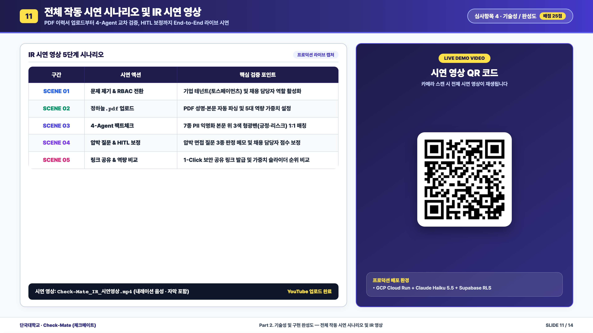
  </a>
</p>

| 시연 구간 | 핵심 시연 액션 | 검증 포인트 |
| :---: | :--- | :--- |
| **SCENE 01** | **문제 제기 & 기업별 RBAC 스위처 전환** | 스타트업 서류 심사 병목 소개 및 `토스페이먼츠` 테넌트 · `채용 담당자(Recruiter)` 권한 활성화 |
| **SCENE 02** | **신규 자소서 PDF 업로드 & 직무 가중치 설정** | `정하늘.pdf` 업로드 즉시 성명·본문 자동 추출 및 5대 직무 역량 가중치 슬라이더 설정 |
| **SCENE 03** | **7종 PII 익명화 & 원문 3색 형광펜 팩트체크** | `[성명·학교명·전화번호 익명화]` 본문 위 AI 발췌 근거(긍정 녹색·확인 황색·리스크 적색) 1:1 매칭 |
| **SCENE 04** | **맞춤형 압박 면접 질문 & 사람 검토(HITL) 보정** | 의심 구간 타깃 압박 질문 3종 판정(`+3` / `0` / `-5`) 기록 및 채용 담당자 점수·사유 직접 보정 |
| **SCENE 05** | **1-Click 보안 공유 링크 & 다차원 역량 비교** | 면접관 전용 만료 기한 보안 링크 발급, 가중치 슬라이더 순위 재계산 및 N-gram 표절 매트릭스 검증 |

---

## 🖼️ 2. 캡스톤 디자인 경진대회 포스터 (90 × 140cm)

> 📄 **인쇄용 고해상도 파일 열람**: **[`poster_90x140.pdf` (벡터 PDF)](poster_90x140.pdf)** | **[`poster_90x140.png` (원본 PNG)](poster_90x140.png)**

<p align="center">
  <a href="./poster_90x140.pdf">
    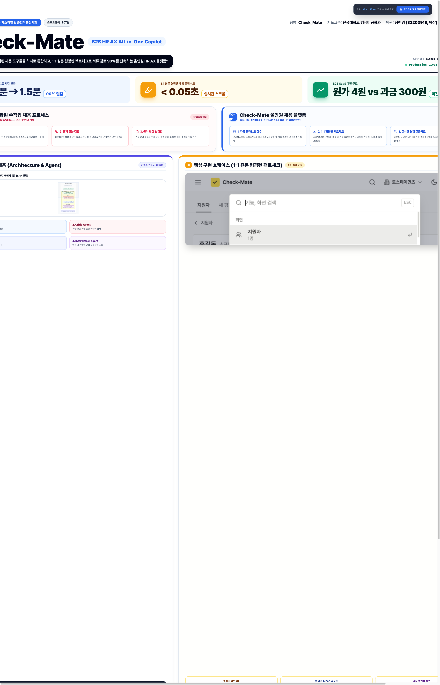
  </a>
</p>

---

## 📊 3. 경진대회 발표 자료 전체 미리보기 (총 14슬라이드)

> 📑 **발표 자료 전체 파일**: **[`presentation_slides.pdf` (발표용 PDF)](presentation_slides.pdf)** | **[`presentation_slides.html` (웹 슬라이드 뷰어)](presentation_slides.html)** | **[`docs/PRESENTATION_SCRIPT.md` (슬라이드별 발표 대본 & 예상 Q&A)](docs/PRESENTATION_SCRIPT.md)**

### Part 1. 프로젝트 표지 · 문제 인식 · 차별성 (Slide 01 ~ 03)
| Slide 01 · 표지 및 시연 QR | Slide 02 · 채용 현장의 3대 병목 (4컷 만화) |
| :---: | :---: |
| 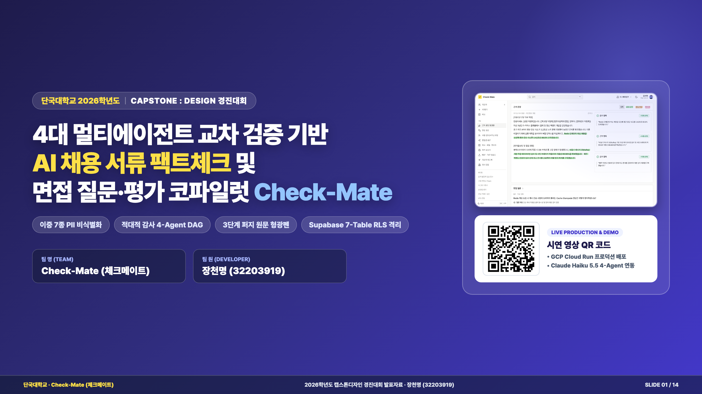 | 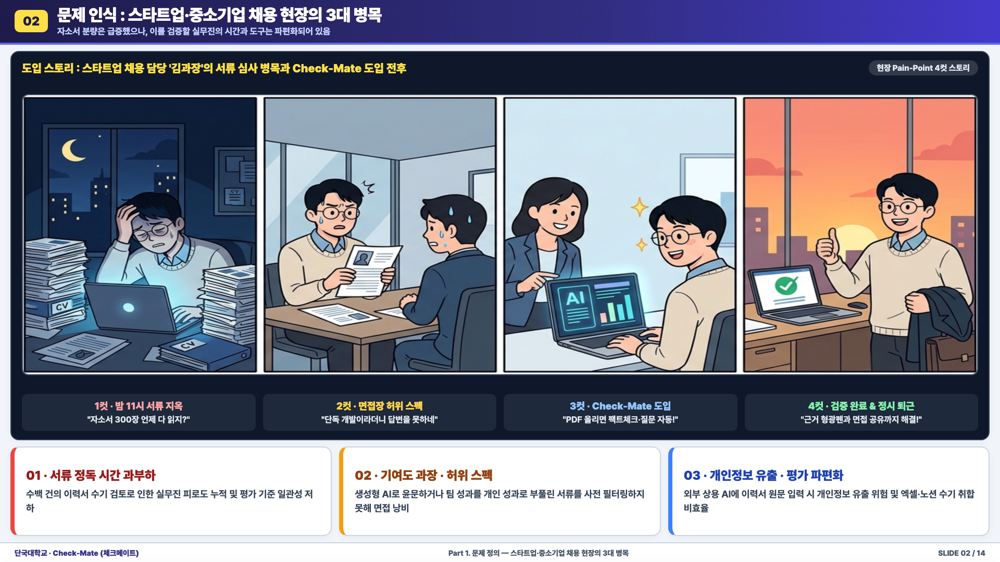 |
| **Slide 03 · 기존 도구 대비 차별성 & 5단계 파이프라인** | **Slide 04 · 4대 멀티에이전트 적대적 교차 검증(DAG)** |
| 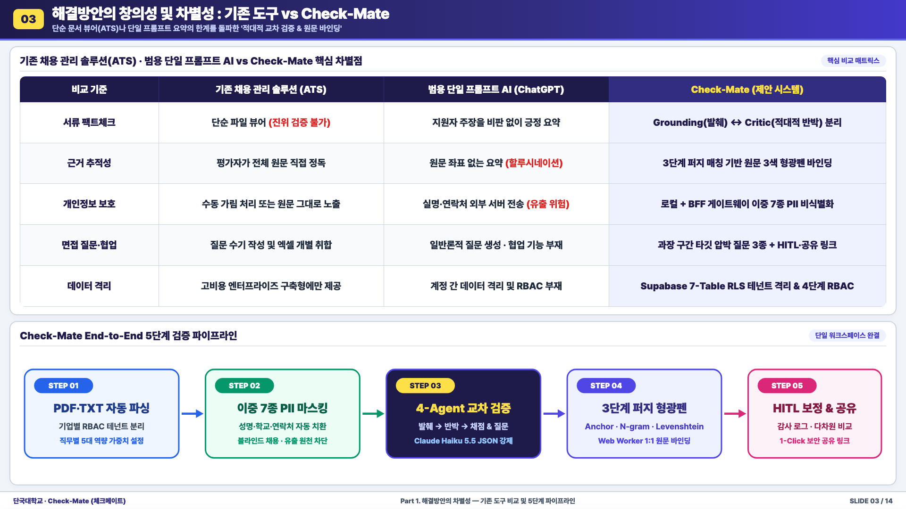 | 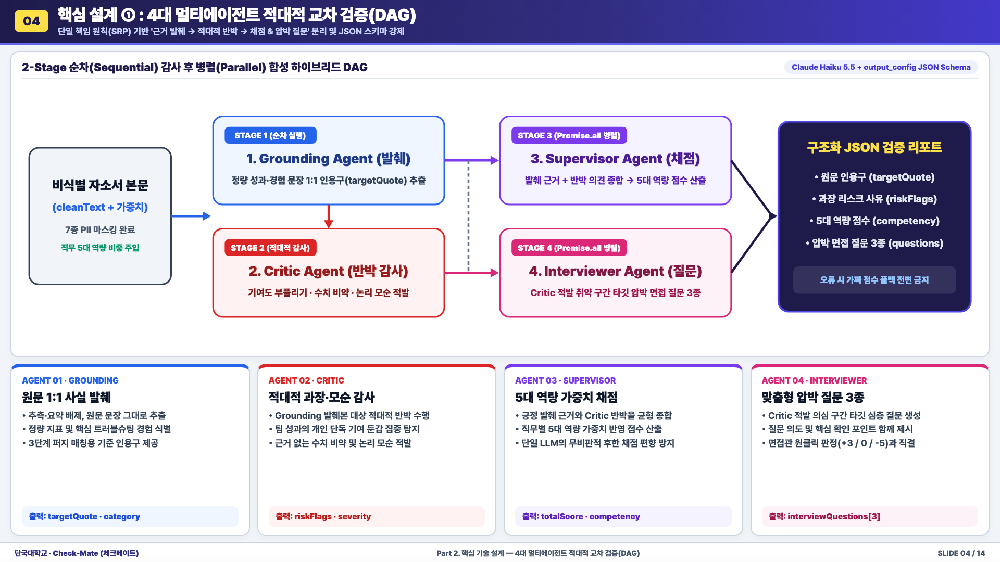 |

### Part 2. 핵심 알고리즘 · 시스템 아키텍처 · 멀티테넌트 DB 설계 (Slide 05 ~ 08)
| Slide 05 · 이중 방어선 7종 개인정보(PII) 비식별화 | Slide 06 · 3단계 퍼지(Fuzzy) 원문 오프셋 바인딩 |
| :---: | :---: |
| 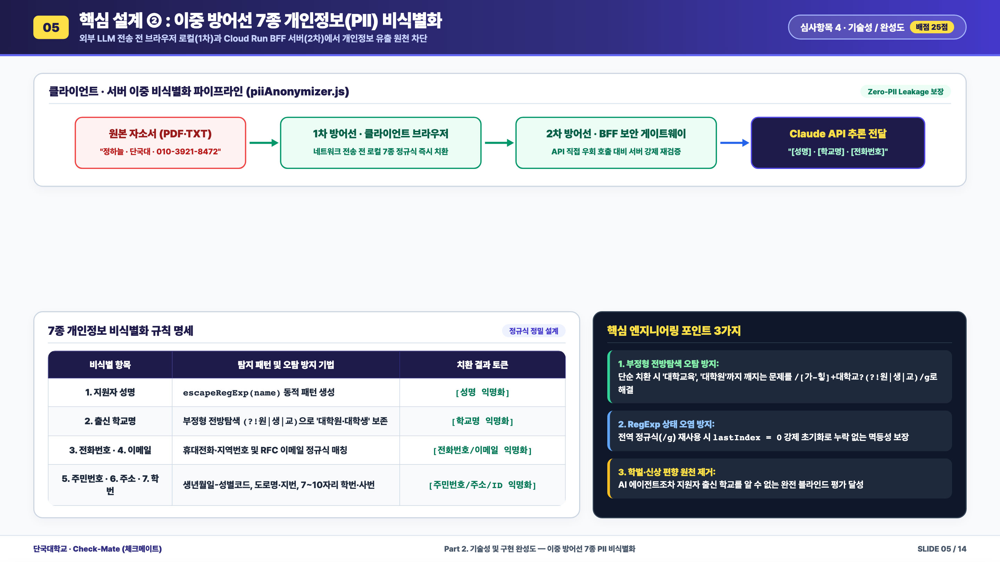 | 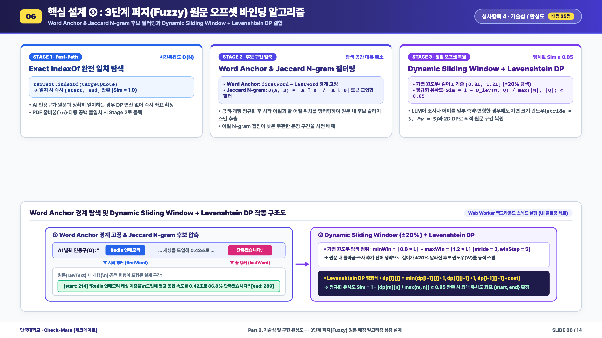 |
| **Slide 07 · 전체 시스템 아키텍처 및 핵심 기술 스택** | **Slide 08 · Supabase PostgreSQL 7-Table 스키마(ERD) & RLS** |
| 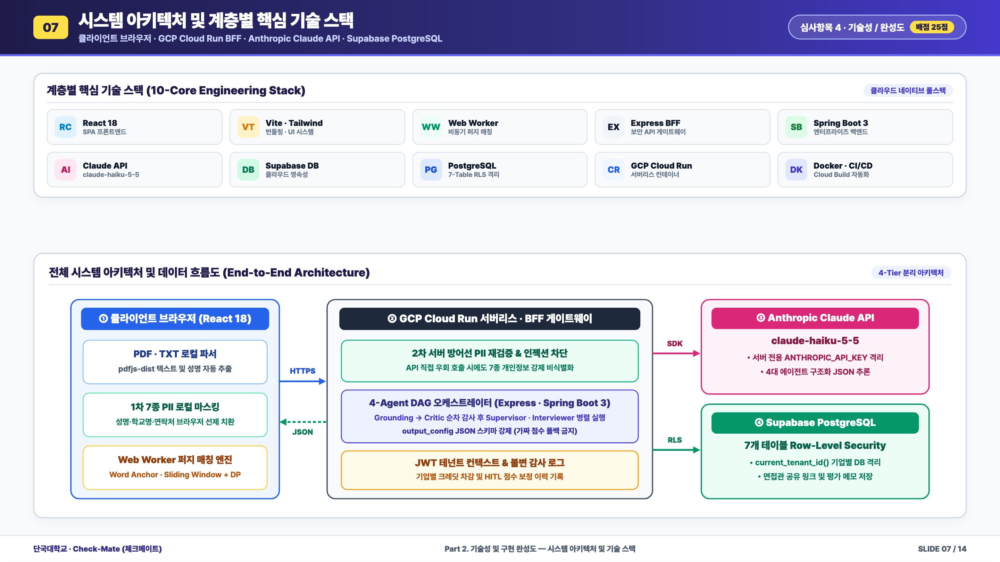 | 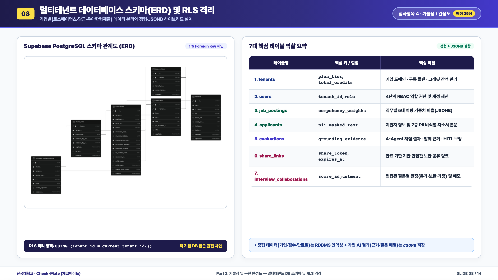 |

### Part 3. 프로덕션 구현 화면 · 시연 · 시장성 · 수익모델 · 로드맵 (Slide 09 ~ 14)
| Slide 09 · 구현 결과 ① (RBAC · PDF 업로드 · 3색 형광펜) | Slide 10 · 구현 결과 ② (압박 면접 질문 · HITL · 다차원 비교) |
| :---: | :---: |
| 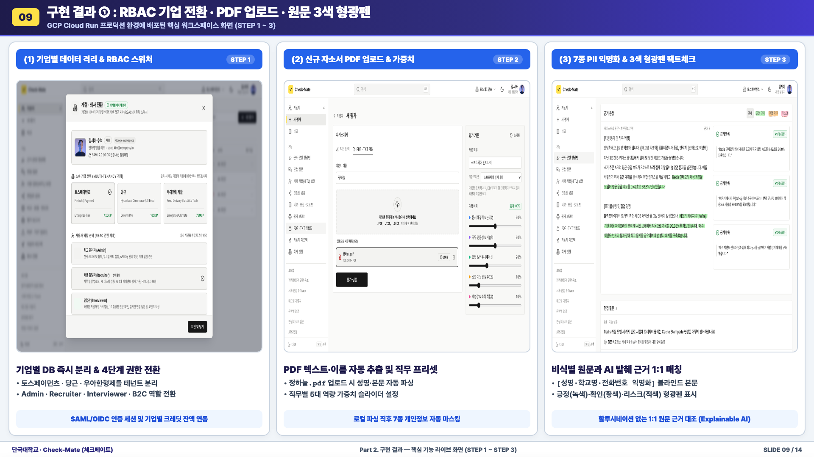 | 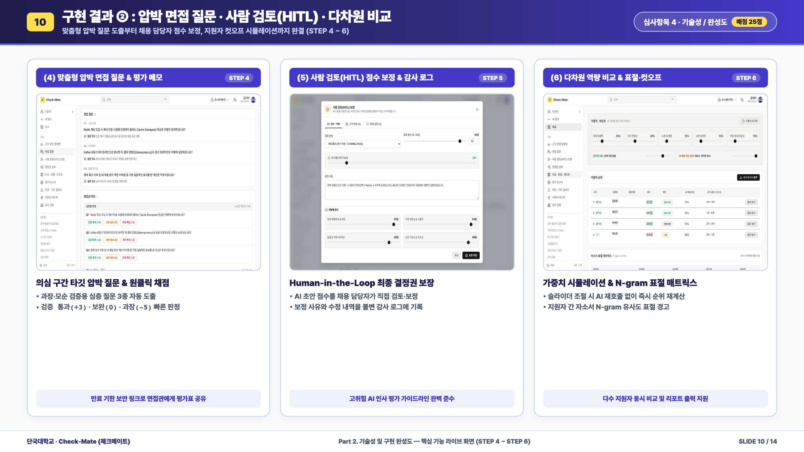 |
| **Slide 11 · 전체 작동 시연 시나리오 및 시연 영상 QR** | **Slide 12 · 목표 시장 및 3대 타겟 고객군** |
|  | 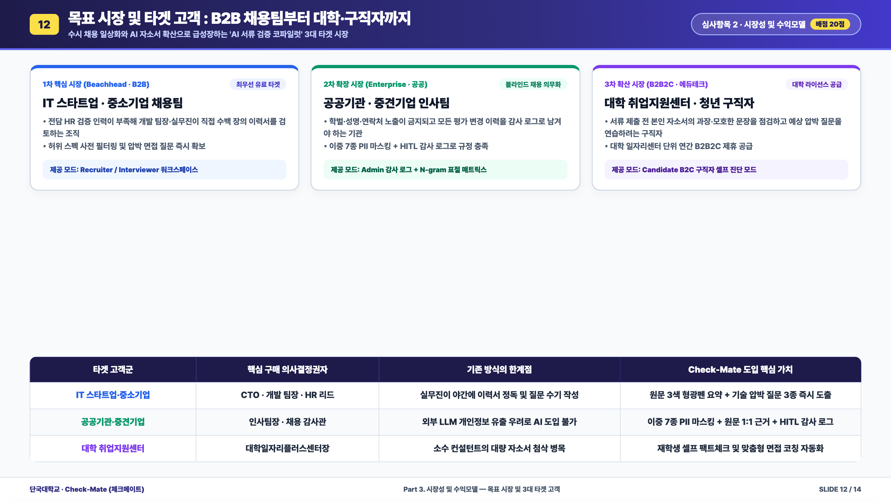 |
| **Slide 13 · 3-Tier SaaS 구독 + AI 크레딧 수익모델** | **Slide 14 · 사업화 로드맵 · 1인 풀스택 역량 및 Q&A** |
| 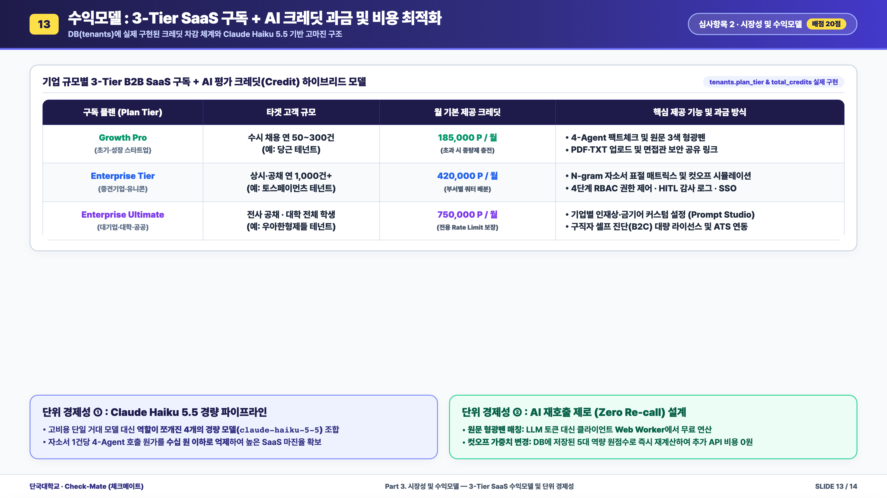 | 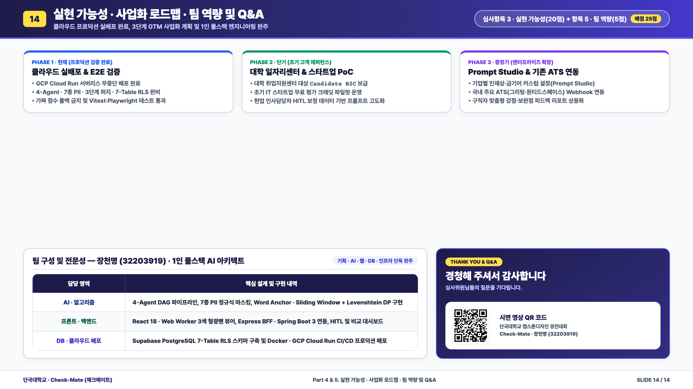 |

---

## 🧠 4. 핵심 엔지니어링 및 알고리즘 설계

### ① 4대 멀티에이전트 적대적 교차 검증(DAG) 파이프라인 (`Front/services/multiAgentEvaluator.js`)
단일 프롬프트 LLM의 '무비판적 긍정 요약'과 '원문 없는 점수 날조(할루시네이션)'를 방지하기 위해 **단일 책임 원칙(SRP)**에 따라 4개의 에이전트로 역할을 분리하고 **2-Stage 순차 감사 후 병렬 합성(DAG)**으로 오케스트레이션합니다.

| 에이전트 | 실행 단계 | 핵심 책임 | 핵심 구조화 출력 (`output_config.format`) |
| :--- | :---: | :--- | :--- |
| **1. Grounding Agent** | `Stage 1 (순차)` | 자기소개서 본문 내 정량 성과·경험 문장 1:1 그대로 발췌 | 원문 인용구 배열 (`targetQuote`) |
| **2. Critic Agent** | `Stage 2 (순차)` | 기여도 부풀리기·수치 비약·논리 모순 집중 적대적 반박 | 과장 의심 사유·리스크 태그 (`riskFlags`) |
| **3. Supervisor Agent** | `Stage 3 (병렬)` | 발췌 근거와 반박 의견을 종합해 5대 직무 역량 채점 | 5대 역량 점수 · 종합 판정 (`competencyScores`) |
| **4. Interviewer Agent** | `Stage 4 (병렬)` | Critic 지적 사항을 면접장에서 검증할 압박 질문 도출 | 맞춤형 압박 면접 질문 3종 (`interviewQuestions`) |

---

### ② 이중 방어선 7종 개인정보(PII) 비식별화 (`Front/utils/piiAnonymizer.js`)
외부 LLM 서버로 지원자 개인정보가 유출되거나 출신 학교에 따른 학벌 편향이 발생하는 것을 원천 차단하기 위해 **클라이언트 브라우저(1차)**와 **Cloud Run BFF 게이트웨이(2차)**에서 7종 개인정보를 강제 치환합니다.

- **7종 마스킹 대상**: `1. 성명` (`[성명 익명화]`), `2. 출신 학교명` (`[학교명 익명화]`), `3. 전화번호` (`[전화번호 익명화]`), `4. 이메일` (`[이메일 익명화]`), `5. 주민등록번호` (`[주민번호 익명화]`), `6. 도로명·지번 주소` (`[주소 익명화]`), `7. 학번·사번 ID` (`[ID 익명화]`)
- **오탐 방지 정규식 설계**: 부정형 전방탐색 `/(?!원|생|교)/`를 적용하여 `'단국대학교'`는 `[학교명 익명화]`로 치환하되, `'대학교육'`, `'대학원'`, `'대학생'` 등 일반 명사는 손상 없이 보존합니다.

---

### ③ 3단계 퍼지(Fuzzy) 원문 오프셋 바인딩 알고리즘 (`Front/utils/fuzzyMatcher.js`)
PDF 파싱 과정에서 발생한 줄바꿈(`\n`)·다중 공백이나 LLM 인용구의 미세한 조사 변형에도 원문 내 정확한 형광펜 좌표(`[start, end]`)를 복원하기 위해 **Web Worker 백그라운드 스레드**에서 3단계 매칭을 수행합니다.

1. **Stage 1 — Exact IndexOf 완전 일치 탐색 (`O(N)`)**
   - `rawText.indexOf(targetQuote)`로 완전 일치 시 DP 연산 없이 즉시 `[start, end]` 반환 (`similarity = 1.0`)
2. **Stage 2 — Word Anchor & Jaccard N-gram 후보 필터링**
   - 공백·개행 정규화 후 인용구의 **시작 어절(`firstWord`)과 끝 어절(`lastWord`) 경계를 앵커링(Word Anchor)**하여 원문 전체가 아닌 후보 슬라이스 구간만 추출하고, 어절 토큰 교집합 비율($J(A, B) = \frac{|A \cap B|}{|A \cup B|}$)로 무관한 문장 구간을 사전 배제하여 탐색 공간을 압축
3. **Stage 3 — Dynamic Sliding Window ($\pm 20\%$) + Levenshtein DP**
   - 원문 내 개행·조사 가감으로 길이가 달라진 구간을 찾기 위해 인용구 길이 $L$ 기준 **$\pm 20\%$ 가변 윈도우($[0.8L, 1.2L]$, `stride = 3`, `winStep = 5`)**를 동적 스캔
   - 2차원 편집거리 점화식 `dp[i][j] = min(dp[i-1][j]+1, dp[i][j-1]+1, dp[i-1][j-1]+cost)`로 정규화 유사도 $\text{Sim} = 1 - \frac{D_{\text{lev}}(W, Q)}{\max(|W|, |Q|)} \ge 0.85$를 만족하는 최대 유사도 원문 좌표 `{start, end}` 확정

---

### ④ Supabase PostgreSQL 7-Table 멀티테넌트 DB 스키마 및 RLS 격리 (`Infra/supabase_schema.sql`)

<p align="center">
  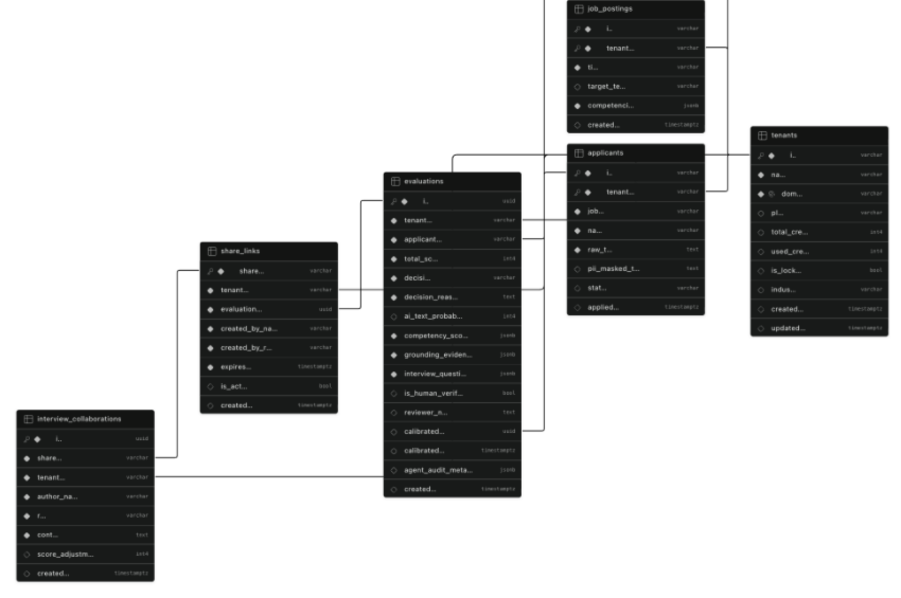
</p>

- **7대 핵심 테이블**: `1. tenants` (기업 도메인·구독 플랜·크레딧 잔액), `2. users` (4단계 RBAC 권한), `3. job_postings` (직무별 5대 역량 가중치 JSONB), `4. applicants` (7종 PII 비식별 원문), `5. evaluations` (4-Agent 평가 결과·근거·HITL 보정 내역), `6. share_links` (만료 기한 보안 공유 토큰), `7. interview_collaborations` (면접관 질문별 판정 및 평가 메모)
- **Row-Level Security (RLS)**: `USING (tenant_id = current_tenant_id())` 정책을 통해 `토스페이먼츠`, `당근`, `우아한형제들` 등 테넌트 간 데이터 접근을 DB 엔진 레벨에서 격리

---

## 💻 5. 프로덕션 6단계 핵심 기능 화면 (GCP Cloud Run Live)

| (1) 기업별 데이터 격리(Multi-Tenancy) & RBAC 스위처 | (2) 신규 자기소개서 PDF 업로드 & 이름 자동 추출 |
| :---: | :---: |
| 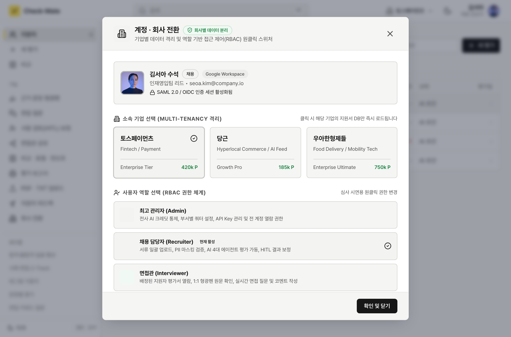 | 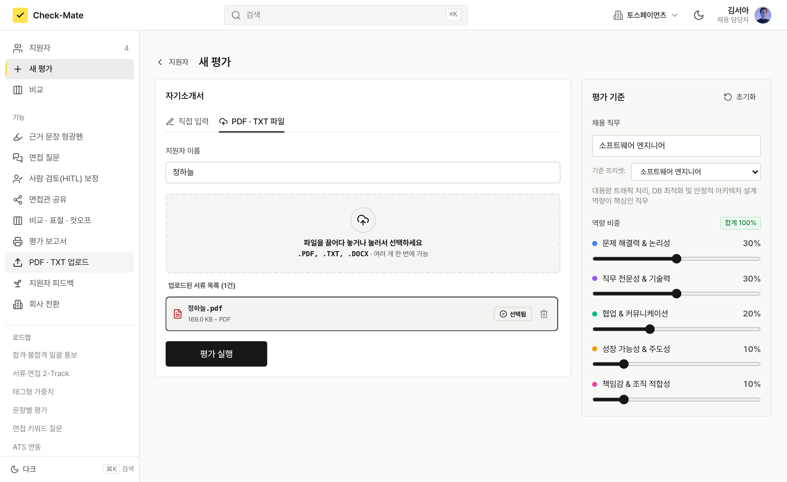 |
| **(3) 7종 PII 익명화 & 원문 3색 형광펜 팩트체크** | **(4) 맞춤형 압박 면접 질문 & 면접관 평가 메모** |
| 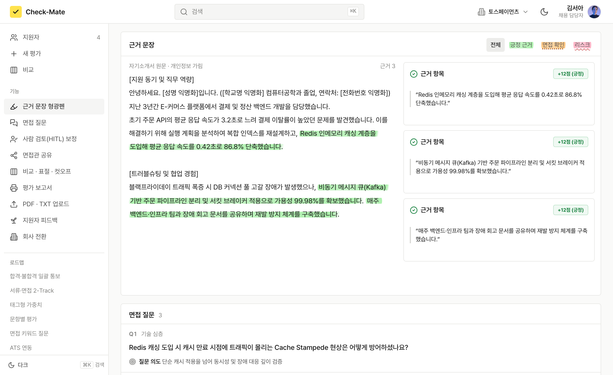 | 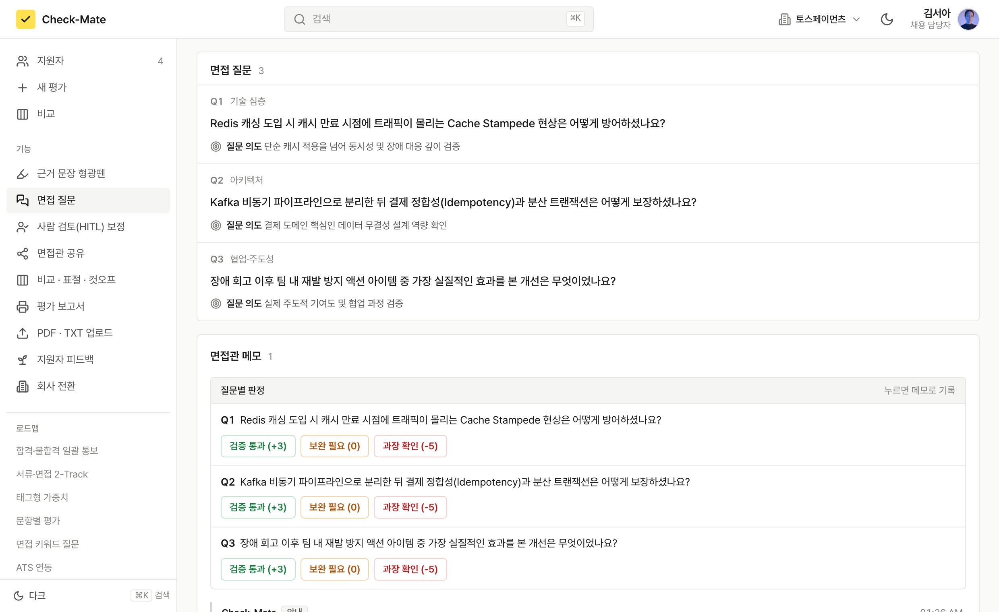 |
| **(5) 사람 검토(HITL) 점수 보정 & 1-Click 공유** | **(6) 지원자 다차원 역량 비교 & 컷오프 대시보드** |
| 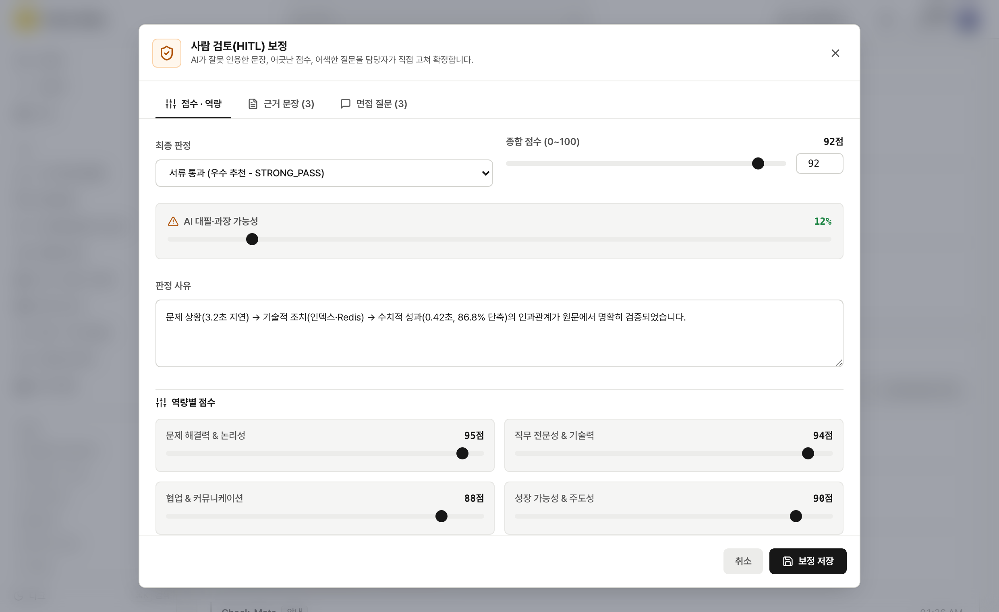 | 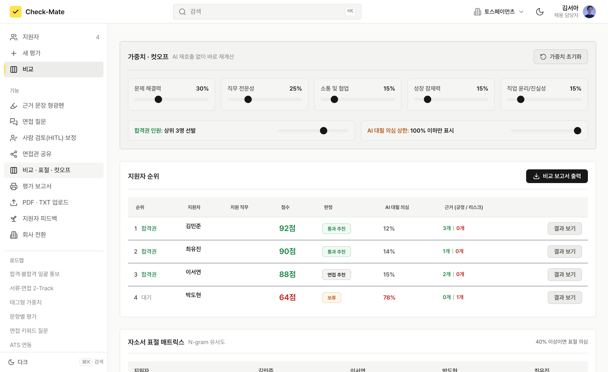 |

---

## 📂 6. 저장소 디렉터리 구조 (Repository Structure)

```text
CapStone-SW-/
├── Front/                           # React 18 프론트엔드 및 핵심 알고리즘 모듈
│   ├── services/
│   │   ├── multiAgentEvaluator.js   # 4대 멀티에이전트 적대적 교차 검증(DAG) 오케스트레이터
│   │   └── agents/                  # Grounding, Critic, Supervisor, Interviewer 에이전트 프롬프트·스키마
│   ├── utils/
│   │   ├── piiAnonymizer.js         # 7종 개인정보(PII) 정규식 비식별화 및 오탐 방지 엔진
│   │   ├── fuzzyMatcher.js          # 3단계 퍼지 매칭 (Word Anchor, Jaccard N-gram, Sliding Window + DP)
│   │   └── plagiarismEngine.js      # 지원자 간 N-gram 자소서 표절 유사도 매트릭스 연산
│   ├── workers/
│   │   └── evaluatorWorker.js       # Web Worker 백그라운드 비동기 퍼지 매칭 스레드
│   ├── contexts/                    # Multi-Tenancy 테넌트 분리 및 4단계 RBAC 권한 컨텍스트
│   └── components/                  # 3색 형광펜 뷰어, 압박 질문 키트, HITL 보정 모달, 역량 비교 대시보드
├── Backend/                         # 백엔드 API 게이트웨이 및 코어 서버
│   ├── gateway/                     # Express 5 보안 BFF 게이트웨이 (2차 PII 검증 및 Claude API 연동)
│   └── spring/                      # Spring Boot 3 엔터프라이즈 코어 백엔드
├── Infra/                           # 클라우드 인프라 · DB 스키마 · 배포 구성
│   ├── supabase_schema.sql          # Supabase PostgreSQL 7-Table 멀티테넌트 DDL 및 RLS 정책
│   ├── k8s/                         # Kubernetes 배포 매니페스트
│   ├── terraform/                   # Terraform 클라우드 프로비저닝 코드
│   └── deploy/                      # VM + Cloudflare Tunnel 배포 구성
├── docs/
│   ├── IR_PITCH_SCRIPT_7MIN.md      # 창업경진대회 7분 발표 + 3분 Q&A 완벽 대본 (16장 기준)
│   ├── submission/
│   │   ├── Check-Mate_사업계획서.pdf # 창업경진대회 최종 사업계획서 (A4 8페이지 PDF)
│   │   ├── business_plan.html       # 사업계획서 원본 HTML
│   │   └── diagrams/                # 아키텍처·시장규모·BM·로드맵 다이어그램 에셋
│   ├── PRESENTATION_SCRIPT.md       # 캡스톤 14장 슬라이드별 발표 대본 및 Q&A 스크립트
│   ├── FINAL_GRADUATION_REPORT.html # 최종 결과보고서 원본 HTML
│   └── assets/                      # 포스터·슬라이드·프로덕션 캡처 이미지 에셋
├── CheckMate_IR_발표자료.pdf         # 창업경진대회 최종 IR 발표 자료 (16:9 와이드 16장 PDF)
├── ir_pitch_deck_v2.html            # 창업경진대회 최종 IR 발표 자료 원본 HTML
├── poster_90x140.pdf                # 캡스톤 디자인 경진대회 포스터 (90x140cm 인쇄용 PDF)
├── poster_90x140.png                # 캡스톤 디자인 경진대회 포스터 (고해상도 PNG)
├── poster_90x140.html               # 캡스톤 디자인 포스터 원본 HTML/CSS
├── presentation_slides.pdf          # 캡스톤 경진대회 발표 자료 (16:9 와이드 14장 PDF)
├── presentation_slides.html         # 캡스톤 경진대회 발표 자료 원본 HTML
├── Check-Mate_IR_시연영상.mp4        # 내레이션 및 자막 포함 전체 작동 시연 영상 (MP4)
└── FINAL_GRADUATION_REPORT.pdf      # 캡스톤 디자인 최종 결과보고서 (A4 7페이지 PDF)
```

---

## 🛠️ 7. 로컬 실행 및 테스트 검증 방법

> **권장 환경**: Node.js `22.12+`

```bash
# 1. 의존성 패키지 설치
npm install

# 2. 로컬 개발 서버 실행 (http://localhost:3000)
npm run dev

# 3. 단위 테스트 스위트 실행 (Vitest — 35개 스위트 · 183개 테스트 검증)
npm test

# 4. 프로덕션 빌드 번들 무결성 검증
npm run build
```

---

© 2026 단국대학교 · **팀 Check-Mate (체크메이트)** · **장천명 · 박상윤**. All rights reserved.
