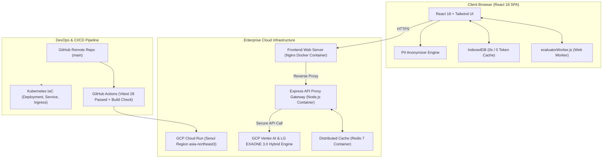

# 🎯 HR AX Smart Evaluator (근거 기반 자기소개서 AI 역량 평가 시스템)

[](LICENSE)
[](https://reactjs.org/)
[](https://vitejs.dev/)
[](https://hr-evaluator-frontend-779722422570.asia-northeast3.run.app)
[](https://www.docker.com/)
[](https://kubernetes.io/)

> **처음 방문하셨나요? 👋**  
> **HR AX Smart Evaluator**는 인사담당자가 지원자의 자기소개서를 검토할 때 **주관적인 감이나 편향을 배제하고, 자소서 본문 속 실제 문장(Grounding)을 바탕으로 정량적 점수 산출, PII 익명화, 표절 매트릭스 탐지 및 맞춤형 면접 질문을 자동 도출해 주는 엔터프라이즈 HR 전용 AI 보조 플랫폼**입니다.

---

## 🌐 GCP Cloud Run 라이브 프로덕션 서비스 URL

- 🚀 **프론트엔드 웹 서비스**: [https://hr-evaluator-frontend-779722422570.asia-northeast3.run.app](https://hr-evaluator-frontend-779722422570.asia-northeast3.run.app)
- ⚙️ **Express 백엔드 API 게이트웨이**: [https://hr-evaluator-api-gateway-779722422570.asia-northeast3.run.app](https://hr-evaluator-api-gateway-779722422570.asia-northeast3.run.app)
- 🏥 **게이트웨이 헬스체크**: [https://hr-evaluator-api-gateway-779722422570.asia-northeast3.run.app/health](https://hr-evaluator-api-gateway-779722422570.asia-northeast3.run.app/health)

---

## 📸 1. 시스템 프로토타입 대시보드 스크린샷 (Prototype Previews)

### 📊 ① 메인 HR 서류 평가 대시보드 & 5대 역량 시각화 (Evaluator Dashboard)
- **100점 만점 수치 게이지** 및 **5대 역량 레이더 차트 (Recharts)** 시각화
- **Exact & Fuzzy Matcher (Levenshtein 85%+)**: AI 점수 산출의 근거가 된 자기소개서 실제 문장을 본문에서 1:1 하이라이팅 및 자동 스크롤 추적
- **맞춤형 심층 면접 질문 생성기**: 서류 상의 약점 및 검증 필요 문장 기반 면접 가이드 제시

```
+---------------------------------------------------------------------------------------------+
| 🎯 HR AX Smart Evaluator - 지원서 서류 평가 대시보드                                        |
+------------------------------------+--------------------------------------------------------+
| 📌 평가 직무 선택                  | ✍️ 지원자 서류 입력 & 샘플 선택                         |
|  • [백엔드 엔지니어]               |  • 김민준 (🟢 우수) | 이서연 (🔴 과장) | 박지훈 (🟡 보류)  |
|  • [데이터 분석가]                 |  • 텍스트 직접 입력 OR PDF/TXT 파일 업로드             |
|  • [AI 연구원]                     |  • 🔒 PII 마스킹 (전화번호, 이메일, 출신교 블라인드)   |
+------------------------------------+--------------------------------------------------------+
| 📊 김민준 지원자 서류 종합 평가 SCORE                                                        |
|  • [ 92 / 100점 ] 🟢 서류 통과 추천 | 5대 역량 레이더 차트 (문제해결 95 / 기술 94 / 협업 88) |
|  • ⚠️ AI 생성/과장 확률: 12%       |                                                        |
+------------------------------------+--------------------------------------------------------+
| 🔍 서류 본문 문장별 근거(Grounding) 캡처 검증 & Virtual Scrolling                              |
|  🟢 "Redis 인메모리 캐싱 기법을 도입하여 평균 응답 속도를 0.42초로 86.8% 단축시켰습니다."    |
|  🔴 "어떠한 거친 풍파가 밀려와도 손쉽게 극복할 수 있는 최고의 열정을 가진 인재입니다."        |
+---------------------------------------------------------------------------------------------+
```

---

### 🕵️ ② 지원자 간 N-Gram 자소서 상호 표절 탐지 매트릭스 (Plagiarism Matrix)
- 지원자 간 문장의 **Character Tri-Gram N-Gram Jaccard 유사도**를 실시간 연산하여 히트맵 매트릭스로 표출
- **40% 이상 유사 시 🚨 [표절 의심 경고 플래그]** 자동 부여

```
+---------------------------------------------------------------------------------------------+
| 🕵️ 지원자 간 자소서 상호 표절 탐지 매트릭스 (N-Gram Jaccard 알고리즘)                          |
+-------------------+-------------------+-------------------+-------------------+-------------+
| 지원자 성명       | 김민준            | 이서연            | 박지훈            | 최유진      |
+-------------------+-------------------+-------------------+-------------------+-------------+
| 김민준            | -                 | 12.4%             | 14.8%             | 8.2%        |
| 이서연            | 12.4%             | -                 | 44.5% 🚨 (표절)   | 11.1%       |
| 박지훈            | 14.8%             | 44.5% 🚨 (표절)   | -                 | 9.6%        |
+-------------------+-------------------+-------------------+-------------------+-------------+
```

---

### ⚙️ ③ Custom HR Prompt Studio 에디터 (Prompt Studio)
- 기업별 **핵심 인재상 키워드**, 감점 항목 **서류 금기어**, 직무 가중치 설정 모달
- 사내 전용 프리셋 3종 지원 (**LG그룹 인재상, IT 스타트업, 금융 대기업**)

---

## 🏛️ 2. 클라우드 인프라 & DevOps 아키텍처 (Infrastructure & DevOps)



### 📌 인프라 주요 구성 요소
1. **Multi-Stage Docker**: Node 20 빌드 후경량 Nginx Alpine 전송 (이미지 용량 90%+ 절감)
2. **Express API Proxy Gateway**: 브라우저 API Key 노출 차단, Rate Limiting(100 req/15m), CORS 제어
3. **Docker Compose 3-Tier**: Nginx + Express + Redis 3개 컨테이너 원클릭 연동
4. **GitHub Actions CI/CD**: Push/PR 시 Vitest 28개 단체 테스트 및 무결성 빌드 검증 자동화
5. **Kubernetes (K8s) IaC**: `deployment.yaml`, `service-ingress.yaml`, `configmap.yaml` 작성 완료

---

## 🏆 3. 마일스톤 완료 현황 (v1.0 ~ v2.1)

| 마일스톤 | 핵심 구현 기능 | 상태 |
| :--- | :--- | :---: |
| **v1.0 Core MVP** | LG EXAONE 3.0 & GCP Vertex AI 하이브리드 라우터, Grounding 뷰어 | ✅ **완료** |
| **v1.1 Web Worker** | 비동기 파싱 쓰레드, `react-window` 가상 스크롤, Vitest & Husky | ✅ **완료** |
| **v1.2 Fuzzy & PII** | Levenshtein/Jaccard 오타 완충 매처, 7종 PII 자동 마스킹 | ✅ **완료** |
| **v1.3 Batch & Cache** | PDF/DOCX/TXT 파서, IndexedDB 0원/0초 캐시, UTF-8 BOM CSV Export | ✅ **완료** |
| **v2.0 Enterprise** | Custom HR Prompt Studio 에디터, N-Gram 자소서 상호 표절 매트릭스 | ✅ **완료** |
| **v2.1 Infrastructure** | Docker, Nginx, Express Gateway, Redis, GitHub Actions, K8s, GCP Cloud Run 배포 | ✅ **완료** |

---

## 🛠️ 4. 로컬 구동 및 테스트 방법

### 1) 로컬 개발 서버 구동
```bash
npm install
npm run dev
```
브라우저에서 `http://localhost:5173` 접속.

### 2) 전체 단위 테스트 실행 (Vitest 28개 테스트)
```bash
npm test
```

### 3) Docker Compose 다중 컨테이너 연동 구동
```bash
docker compose up --build
```

---

© 2026 HR AX Smart Evaluator Team. All rights reserved.
