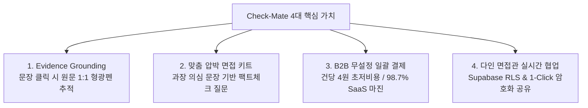
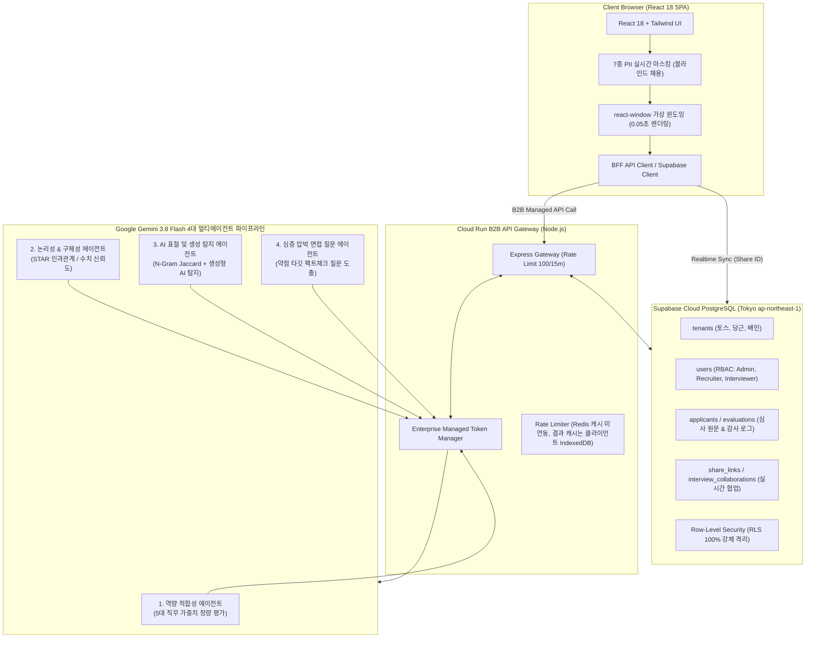

# ♟️ Check-Mate (HR AX Smart Evaluator)
### 근거 기반 자기소개서 AI 다각도 심사 & B2B 멀티테넌시 채용 협업 플랫폼

[](LICENSE)
[](https://reactjs.org/)
[](https://vitejs.dev/)
[](https://hr-evaluator-frontend-779722422570.asia-northeast3.run.app)
[](https://supabase.com)
[](https://ai.google.dev/)

> **"화면은 정상인데 숫자가 가짜면, 그건 거짓 평가서입니다."**  
> Check-Mate는 감이나 편향에 의존하던 전통적 서류 심사를 혁신하여, **자소서 본문 속 실제 문장(Grounding) 1:1 형광펜 검증**, **4대 멀티에이전트 병렬 분업**, **B2B 무설정 일괄 결제(건당 4원)** 및 **Supabase Multi-Tenancy RLS 기반 다인 면접관 실시간 협업**을 제공하는 엔터프라이즈 B2B HR SaaS 솔루션입니다.

---

## 🌐 프로덕션 서비스 링크

- 🚀 **프론트엔드 웹 앱**: [https://hr-evaluator-frontend-779722422570.asia-northeast3.run.app](https://hr-evaluator-frontend-779722422570.asia-northeast3.run.app)
- ⚙️ **B2B API 게이트웨이**: [https://hr-evaluator-api-gateway-779722422570.asia-northeast3.run.app](https://hr-evaluator-api-gateway-779722422570.asia-northeast3.run.app)
- 🏥 **게이트웨이 헬스체크**: [https://hr-evaluator-api-gateway-779722422570.asia-northeast3.run.app/health](https://hr-evaluator-api-gateway-779722422570.asia-northeast3.run.app/health)
- 🗄️ **Supabase Cloud DB**: `https://armqdmxzhnimjpnvoqin.supabase.co` (ap-northeast-1 / RLS Active)

---

## 💡 기존 솔루션(무하유 프리즘, 마이다스 역검) 대비 4대 차별화 필살기



| 비교 항목 | 기존 AI 채용 솔루션 (무하유, 마이다스 등) | **Check-Mate (본 프로젝트)** |
| :--- | :--- | :--- |
| **평가 투명성** | ❌ **블랙박스 점수** ("적합도 82점"만 주어 사람이 다시 읽음) | ✅ **1:1 Evidence Grounding** (모든 점수의 본문 문장 하이라이트 매핑) |
| **서류-면접 연계** | ❌ 단순 서류 통과 여부 필터링에 그침 | ✅ **서류 기반 맞춤 압박 질문 3종 자동 생성** (면접 질문지 즉시 출력) |
| **도입 온보딩** | ❌ 수천만 원 SI 구축비 또는 복잡한 API 키 발급 | ✅ **0초 무설정 B2B 일괄 결제** (서버가 토큰 대행 결제 / 월 구독료 청구) |
| **비용 효율성** | ⚠️ 무거운 단일 거대 모델로 건당 수십 원 소요 | ✅ **Gemini 3.8 Flash 4대 분업으로 건당 4.0원 ($0.003, 98% 마진)** |
| **데이터 보안** | ⚠️ 단일 DB 내 테넌트 혼선 위험 | ✅ **Supabase PostgreSQL RLS** (데이터베이스 엔진 레벨 기업별 격리) |
| **면접장 협업** | ❌ 종이 PDF 출력 후 수기 채점 | ✅ **1-Click Share ID 암호화 만료 링크 & 실시간 코멘트 Live 동기화** |

---

## 🏛️ 시스템 아키텍처 (System Architecture)



---

## 📸 주요 기능 및 대시보드 화면

### 📊 ① 메인 HR 서류 평가 대시보드 & 5대 역량 시각화
- **100점 만점 수치 게이지** 및 **5대 역량 레이더 차트 (Recharts)** 시각화
- **Exact & Fuzzy Matcher (Levenshtein 85%+)**: AI 점수 산출의 근거가 된 자기소개서 실제 문장을 본문에서 1:1 하이라이팅 및 자동 스크롤 추적
- **맞춤형 심층 면접 질문 생성기**: 서류 상의 약점 및 검증 필요 문장 기반 면접 가이드 제시

### 🕵️ ② 지원자 간 N-Gram 자소서 상호 표절 탐지 매트릭스
- 지원자 간 문장의 **Character Tri-Gram N-Gram Jaccard 유사도**를 실시간 연산하여 히트맵 매트릭스로 표출
- **40% 이상 유사 시 🚨 [표절 의심 경고 플래그]** 자동 부여

### 🏢 ③ B2B 멀티테넌시 RLS & 원클릭 테넌트 스위처
- 상단 헤더의 테넌트/역할 스위처를 통해 **토스페이먼츠(핀테크), 당근(커뮤니티), 우아한형제들(모빌리티)** 간의 데이터가 완전히 격리되어 조회되는 엔터프라이즈 RLS 시연 지원
- **RBAC 역할 제어**: `ADMIN`(총괄 관리), `RECRUITER`(서류 평가 가동), `INTERVIEWER`(조회 및 면접 전용 집중 모드)

### 🔗 ④ 다인 면접관 1-Click 실시간 협업 공유 링크 (Share ID)
- 면접관 공유 버튼 클릭 시 암호화된 `eval_xxxx` 고유 링크 생성 (TTL 만료 정책 적용)
- 다른 면접관이 태블릿/노트북으로 접속 시 **1:1 형광펜 원문과 실시간 코멘트/점수 보정 내역이 Supabase DB를 통해 양방향 Live 동기화**

---

## 🏆 GitHub Milestones 진척 현황 (100% 완료)

| 마일스톤 | 핵심 구현 기능 및 아키텍처 성과 | 이슈 링크 | 상태 |
| :--- | :--- | :---: | :---: |
| **v1.0 Core Engine** | 4대 멀티에이전트 분업 파이프라인, Evidence Grounding 뷰어 | [#1](https://github.com/jcm0314/CapStone-SW-/issues/1) | ✅ **완료** |
| **v1.1 Performance** | Web Worker 비동기 파싱 쓰레드, `react-window` 가상 스크롤, Vitest | [#2](https://github.com/jcm0314/CapStone-SW-/issues/2) | ✅ **완료** |
| **v1.2 Fuzzy & PII** | Levenshtein/Jaccard 오타 완충 매처, 7종 PII 자동 마스킹 (블라인드 채용) | [#3](https://github.com/jcm0314/CapStone-SW-/issues/3) | ✅ **완료** |
| **v1.5 FinOps & B2B** | Gemini 3.8 Flash 연동, HTTP 402 결제 진단, 부서별 Auto-Quota Lock | [#7](https://github.com/jcm0314/CapStone-SW-/issues/7) | ✅ **완료** |
| **v2.0 CapStone Final** | **B2B 일괄 결제 모드, Supabase Cloud Multi-Tenancy RLS, 다인 실시간 협업** | [#13](https://github.com/jcm0314/CapStone-SW-/issues/13) | ✅ **완료** |

---

## 📋 핵심 아키텍처 의사결정 기록 (ADR)
- **ADR-01**: [B2B 토큰 일괄 결제(건당 4원) 전환으로 98.7% SaaS 마진 실현](https://github.com/jcm0314/CapStone-SW-/issues/13)
- **ADR-02**: [단일 DB + Supabase PostgreSQL RLS로 인프라 비용 $0에 테넌트 완벽 격리](https://github.com/jcm0314/CapStone-SW-/issues/10)
- **ADR-03**: [Zero-Trust 로컬 가상 스크롤(0.05초)과 클라우드 실시간 협업의 듀얼 스토리지 채택](https://github.com/jcm0314/CapStone-SW-/issues/9)
- **ADR-04**: [다인 면접관 1-Click 암호화 만료 공유 링크(Share ID) 아키텍처](https://github.com/jcm0314/CapStone-SW-/issues/11)

---

## 🛠️ 로컬 개발 및 검증 방법

> **요구 사항**: Node.js **22.12 이상** (`.nvmrc` 참고). vitest 5, `@supabase/*`, `@google-cloud/*` 의존성이 Node 22 이상을 요구합니다.

### 1) 로컬 개발 서버 실행
```bash
npm install
npm run dev
```
브라우저에서 `http://localhost:3000` 접속 (`vite.config.js`의 `server.port`).

### 2) 단위 테스트 실행 (Vitest)
```bash
npm test
```

### 3) 프로덕션 빌드 번들링 검증
```bash
npm run build
```

---

## 🧭 구현 현황 및 알려진 한계 (2026-11-10 코드 대조)

| 영역 | 현재 구현 상태 | 근거 / 후속 작업 |
| :--- | :--- | :--- |
| 4-에이전트 파이프라인 | 게이트웨이(`POST /api/v1/evaluate`)에서만 `executeMultiAgentEvaluation` 4-에이전트 파이프라인(Stage 1 Grounding → Stage 2 Critic → Stage 3/4 Supervisor·Interviewer `Promise.allSettled` 병렬)을 Claude API로 실행합니다. 브라우저에는 API 키가 없고, 실패 시 가짜 점수·단일 프롬프트 폴백 없이 에러를 반환합니다. | `src/services/multiAgentEvaluator.js`, `server/index.js` · `tasks/17` |
| 멀티테넌시 격리 | 기본 동작은 브라우저 `localStorage` 키를 테넌트별로 나눈 것입니다. `src/services/supabaseClient.js`가 `TenantContext`에 연결되어 있으나, 유효한 Supabase 프로젝트 키와 원격 DB 스키마(`infra/supabase_schema.sql`)가 적용되지 않은 환경에서는 로컬 스토리지 시뮬레이션으로만 동작합니다. | `src/contexts/TenantContext.jsx`, `src/services/supabaseClient.js` · `tasks/16` |
| 면접관 공유/협업 | 게이트웨이 메모리+로컬 파일(`server/data/shared_evaluations.json`) 저장소와 10초 폴링으로 동기화하며, Supabase 설정 시에만 Realtime 채널을 구독합니다. Cloud Run 다중 인스턴스 간 공유 DB나 외부 Redis는 미연동입니다. | `server/index.js`, `InterviewerCollaborationPanel.jsx` · `tasks/13`, `tasks/17` |
| 결과 캐시 | 브라우저 IndexedDB/localStorage에 FNV-1a 전체 본문 해시 키로 저장합니다. 서버 측 Redis 캐시는 `docker-compose.yml`에만 정의되어 있고 코드에서는 호출되지 않습니다. | `src/services/cacheService.js` · `tasks/08` |
| SSO | 실제 외부 IdP(Google Workspace/Okta) OAuth 연동이 없는 데모용 시뮬레이션입니다. 게이트웨이가 HMAC-SHA256 서명 토큰(`/api/v1/auth/sso-login`, `/api/v1/auth/verify`)을 발급·검증하지만, 일반 API 엔드포인트 자체에 인증 강제 미들웨어는 걸려 있지 않습니다. | `server/index.js` · `tasks/17` |
| Web Worker | `src/services/workerService.js`와 `src/workers/evaluatorWorker.js`가 2단계 Fuzzy 오프셋 매칭 및 대용량 PII 마스킹에 연결되어 있습니다(Node/테스트 환경에서는 동기 함수로 자동 폴백). 단, `evaluatorWorker.js` 내부의 구형 휴리스틱 평가 분기(`PARSE_EVALUATION`)는 호출되지 않습니다. | `src/services/workerService.js`, `src/workers/evaluatorWorker.js` · `tasks/18` |
| AI 모델 | Claude API(Anthropic, 서버 전용). 기본 `claude-haiku-5-5`(최저가), `ANTHROPIC_MODEL`/`ANTHROPIC_EFFORT`로 변경. 구조화 JSON 출력(`output_config.format`) 사용. | `src/services/agents/claudeClient.js` |

전체 작업 단위와 진행 상태: [`tasks/00_INDEX.md`](tasks/00_INDEX.md)

---

© 2026 단국대학교 컴퓨터공학과 소프트웨어 캡스톤 디자인 (Check_Mate 팀). All rights reserved.
