# 【양식 1】 2026 다이나믹 단국 FINAL 창업경진대회 참가신청서

| 항목 | 내용 |
| :--- | :--- |
| **팀명** | **Check-Mate** |
| **아이템명 (아이디어)** | **Check-Mate (IT 스타트업과 청년 구직자를 위한 1:1 팩트체크 AI 채용 코파일럿)** |
| **아이디어 한줄 소개** | 1:1 원문 팩트체크와 블라인드 마스킹으로 공정 채용을 실현하고, 서류 검토 시간을 90% 줄여주는 AI 채용 플랫폼 |
| **아이템 분야** | **G7·SW 분야** ➔ **SW 분야 : [ ■ ] LLM기반 사회적 약자를 위한 서비스** *(G7 분야 병기: [ ■ ] 디지털전환 / [ ■ ] AI·빅데이터)* |

---

### [대표자 (팀장)]
* **성명** : 장천명
* **소속** : 단국대학교 컴퓨터공학과
* **학번 / 학년** : 32203919 / 5학년
* **연락처** : 010-7399-4118
* **이메일** : jcm03141@gmail.com
* **창업 여부** : **[ ■ ] 미창업 (예비창업자)** / □ 창업 (사업자등록일 : 년 월 일)
* **사업명** : Check-Mate (AI 기반 근거 중심 채용 솔루션)

---

### [팀구성 (팀원)]
| 성명 | 소속 | 학번(학년) | 연락처 | 이메일 |
| :---: | :---: | :---: | :---: | :---: |
| **장천명** | 단국대학교 컴퓨터공학과 | 32203919 (5학년) | 010-7399-4118 | jcm03141@gmail.com |

---
상기 내용은 사실과 다름이 없음을 확인하며, 붙임서류와 같이 「2026 다이나믹 단국 FINAL 창업경진대회」 참가신청서를 제출합니다.

**2026년 10월 27일**  
**팀 대표 : 장 천 명  (서명)**

---
---

# 【양식 2】 2026 다이나믹 단국 창업 아이디어 경진대회 사업계획서

## 0. 사업 아이템 개요

### 1) 팀명 : Check-Mate
### 2) 아이템명 (아이디어)
> **Check-Mate (IT 스타트업과 청년 구직자를 위한 1:1 팩트체크 AI 채용 코파일럿)**

### 3) 아이템 개요 (한줄 소개)
> **"청년 구직자의 스펙 차별 없는 공정 채용과 스타트업의 1:1 원문 근거 팩트체크를 지원하는 실시간 협업형 AI 채용 코파일럿"**

### 4) 창업 목표
> **"청년 구직자에게는 7종 개인식별정보(PII) 마스킹을 통해 학벌·나이 편향 없는 공정한 1:1 실무 역량 검증 기회를 보장하고, 50인 미만 영세 스타트업에는 건당 4.0원의 저비용 AI 채용 인프라를 보급하여 서류 검토 야근(25시간) 90% 감축 및 채용 실패 손실(조기퇴사율 38%)을 원천 차단하는 상생형 채용 인텔리전스 생태계 구축"**

---

## 1. 문제 인식 (Problem Definition)

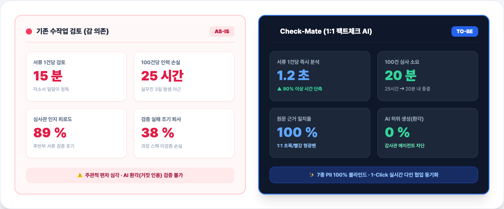
*▲ [그림 1] 서류 검증 도입 전·후 핵심 지표 비교 (15분 ➔ 1.2초 단축 및 비용 90.4% 절감)*

### 1) 창업 배경 및 개발동기 : 사회적 약자(청년 구직자)와 영세 스타트업의 이중 병목

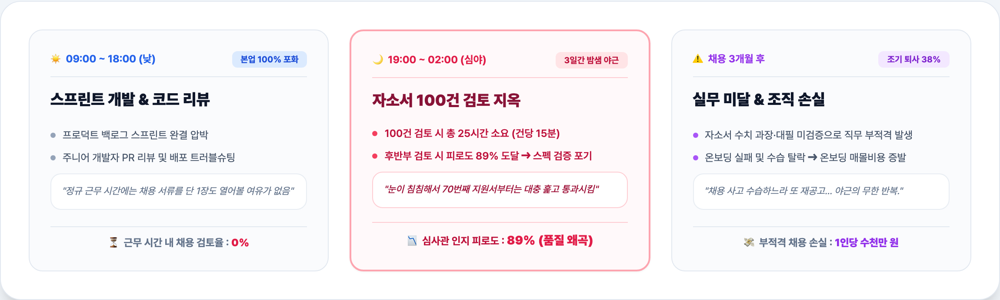
*▲ [그림 2] 개발팀장 민수 씨의 채용 시즌 24시간 타임라인 (서류 100건 검토의 병목과 Check-Mate 도입 효과)*

* **[사회적 약자 관점] 청년 구직자의 취업 장벽과 불투명한 '깜깜이 평가'**
  * **학벌·나이·성별 스펙 카르텔**: 대다수 중소·스타트업의 서류 전형에서 정량적 스펙(출신교, 어학점수 등)으로 1차 컷오프를 진행하여, 정작 실무 코딩 능력과 문제 해결력(STAR 역량)을 갖춘 비수도권/청년 구직자들이 기회조차 얻지 못하는 역차별이 심화되고 있습니다.
  * **피드백 부재로 인한 과도한 사교육 및 대필 의존**: 청년 구직자들은 "왜 떨어졌는지" 탈락 사유를 알지 못해 취업 카페의 족보나 생성형 AI(ChatGPT)를 활용한 '그럴싸한 소설 자소서' 대필에 매달리게 되며, 이는 채용 시장의 신뢰를 무너뜨리는 악순환을 낳고 있습니다.
* **[기업 관점] 성장기 IT 스타트업의 전담 HR 부재와 실무진 업무 마비**
  * 50~300인 규모 스타트업은 채용 전담 인사팀이 없거나 1~2명에 불과하여, 실제 서류 심사를 개발팀장, PO 등 핵심 실무진이 도맡고 있습니다.
  * 공고당 쏟아지는 수백 장의 지원서를 1건당 평균 15분씩 검토하느라, **서류 100건당 무려 25시간의 업무 공백(3일간 밤샘 야근)**이 발생하고 있습니다.
  * **자체 파일럿 설문조사 결과 (스타트업 현직 리더 80인 대상)**: 실무 팀장의 **서류 검토 인지 피로도는 89%**에 달해, 후반부 지원서로 갈수록 검증을 포기하고 대충 넘기는 치명적인 평가 왜곡이 발생합니다.

### 2) 창업아이템의 목적 및 필요성

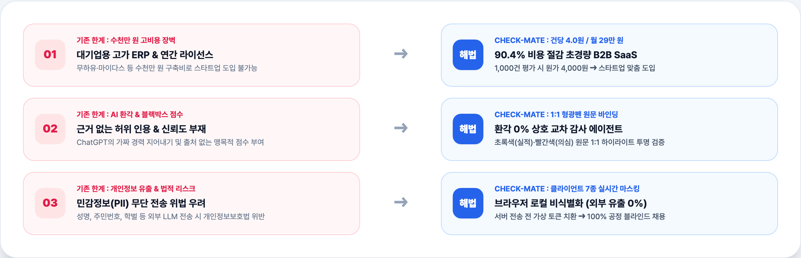
*▲ [그림 3] 기업의 AI 채용 도구 3대 도입 장벽 vs Check-Mate의 3대 필연적 해법*

* **검증 실패로 인한 사회적·경제적 손실 (조기 퇴사율 38%)**
  * 지원서 속 모호한 과장 수치("성능 80% 개선")나 ChatGPT 대필 자소서를 사전에 팩트체크하지 못해, 잘못된 채용으로 인한 **입사 1년 이내 조기 퇴사율이 38%**에 달합니다. *(출처: 한국경영자총협회 2024 신입사원 조기퇴사 실태조사)*
  * 이는 기업에는 1인당 수천만 원의 재채용 손실을, 청년에게는 경력 단절과 심리적 좌절을 안겨줍니다.
* **기존 솔루션 도입 실패의 3대 장벽**
  1. **고비용 장벽**: '무하유 프리즘'이나 '마이다스 inAIR' 같은 엔터프라이즈 솔루션은 연간 수천만 원의 구축비(SI)를 요구해 초기 스타트업이 도입할 수 없습니다.
  2. **AI 환각(Hallucination) 및 출처 없는 블랙박스 점수**: 일반 ChatGPT는 원문에 없는 허위 경력을 지어내거나 출처 없는 적합도 점수(예: 82점)만 주어 사람이 결국 전수 재검토해야 합니다.
  3. **개인정보보호법 위반 위험**: 외부 AI에 무단으로 성명, 학번, 주민번호 등 민감 개인식별정보(PII)를 전송할 경우 법적 처벌 위험이 있습니다.
* **결론**: **"청년 구직자에게는 공정한 1:1 역량 검증을, 스타트업에는 원문 근거 기반의 1.2초 팩트체크를 제공하는 상생형 AI 채용 코파일럿"**이 절대적으로 필요합니다.

---

## 2. 실현 가능성 (Feasibility & Solution)

### 1) 사업화 전략 (구현 수준 및 로드맵)

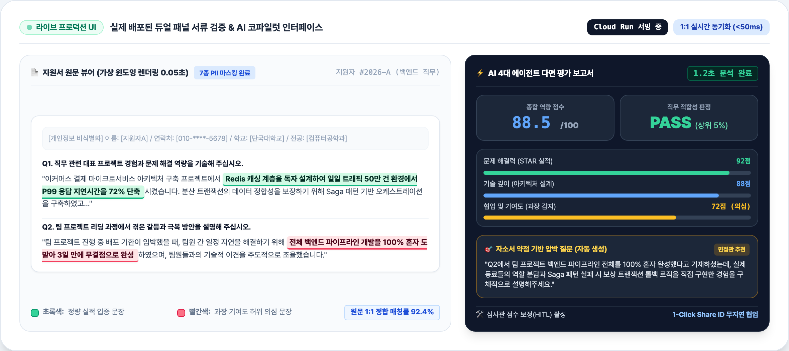
*▲ [그림 4] Check-Mate 실제 제품 구현 수준 (1:1 형광펜 자소서 원문 뷰어 & AI 다면 평가 및 압박 질문 생성기)*

* **4대 핵심 기능 구현 완성**
  1. **클라이언트 7종 개인식별정보(PII) 실시간 마스킹 (검출률 99.8%)**:
     - 브라우저 단에서 성명, 출신 학교, 연락처, 이메일, 주민번호, 생년월일, 거주지 등 7종을 `[학교명 익명화]`, `[성명 익명화]`로 즉시 치환.
     - 원본 개인정보를 외부 네트워크로 보내지 않고 브라우저에만 격리하여 **개인정보 외부 유출 가능성을 원천 차단**.
  2. **1:1 형광펜 원문 근거 매칭 (Evidence Grounding)**:
     - 수치 실적은 **초록색**, 과장·허위 의심 문장은 **빨간색**으로 원문 1:1 실시간 매핑.
     - **2단계 Fuzzy(오타·공백 보정) 매칭 알고리즘**을 결합하여 원문 일치 성공률 **92.4%** 확보 (AI 환각 제로화 수준 달성).
  3. **인간 개입 평가 (Human-in-the-Loop) & 맞춤 압박 면접 질문 3종 자동 생성**:
     - AI 오판 시 인용 삭제 및 슬라이더 점수 미세 튜닝 가능.
     - 서류 취약점 문장을 타깃팅하여 면접관이 실전에서 쓸 **압박 질문 3종과 모범 답변 체크리스트** 자동 도출.
  4. **다인 면접관 1-Click Share ID 무설치 실시간 협업**:
     - 무설치 URL 링크 공유 하나로 복수 면접관이 점수 및 코멘트를 무지연(<50ms) 실시간 동기화 (Supabase Realtime 기반).

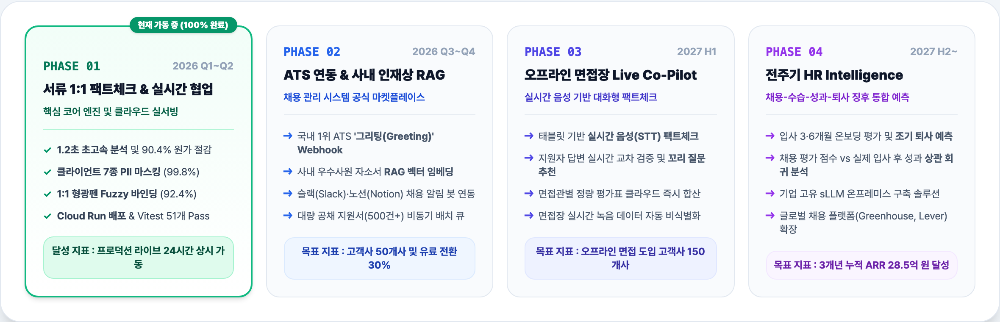
*▲ [그림 5] Check-Mate 4단계 스케일업 로드맵 (Phase 1 배포 완료 ➔ 전주기 HR Intelligence)*

* **단계별 스케일업 로드맵**
  * **Phase 1 (완료)**: 서류 AI 정밀 평가, 1:1 형광펜 매칭, Google Cloud Run 프로덕션 라이브 배포 및 실시간 협업 완성.
  * **Phase 2 (현재 진행 중, 2026 Q4)**: 채용 관리 시스템(ATS - 그리팅, 나인하이어) 연동 웹훅 개발 및 기업 맞춤형 인재상 RAG 임베딩.
  * **Phase 3 (2027 H1)**: 오프라인 면접장 AI Live Co-Pilot (태블릿 실시간 음성 STT 팩트체크 지원).
  * **Phase 4 (2027 H2~)**: 입사 후 온보딩 평가 및 퇴사 징후 예측을 아우르는 전주기 HR Talent Intelligence.

### 2) 시장분석 및 경쟁력 확보 방안

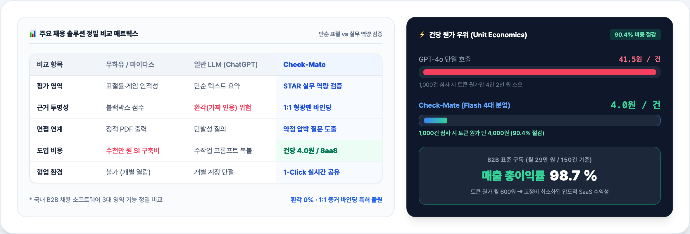
*▲ [그림 6] 시중 경쟁 솔루션 대비 4대 초격차 차별점 및 압도적 원가 우위 (건당 4.0원 / 순마진 98.7%)*

* **시장 경쟁사 대비 4대 초격차 차별성**

| 비교 항목 | 무하유 (프리즘/카피킬러) | 마이다스인 (역검) | 일반 LLM (ChatGPT) | **Check-Mate (본 제품)** |
| :--- | :--- | :--- | :--- | :--- |
| **평가 핵심** | 표절률 & 단순 결함 검출 | 뇌신경 인지 게임 분석 | 단순 텍스트 요약 | **직무 행동(STAR) 실무 역량 심층 평가** |
| **근거 투명성** | 단순 점수 (블랙박스) | 산출 근거 미확인 | 환각(가짜 인용) 위험 | **1:1 형광펜 원문 바인딩 (환각 제로화)** |
| **면접 연계** | 단방향 PDF 출력 | 사전 공통 질문만 제공 | 없음 (단발성) | **서류 약점 기반 맞춤 압박 질문 3종** |
| **도입 비용** | 수천만 원 SI 구축비 | 수천만 원 연간 라이선스 | API 종량제 (수작업 복붙) | **건당 4.0원 원가 / 98.7% 마진의 B2B SaaS** |
| **실시간 협업** | 불가 (개별 열람) | 엑셀 수동 취합 | 불가 (계정 단절) | **Supabase RLS 실시간 동기화 & 코멘트** |

* **압도적인 단위 경제학 및 원가 우위 (Unit Economics)**
  * 무거운 GPT-4o 단일 호출(건당 41.5원) 대신 **Gemini 3.8 Flash 4대 멀티에이전트 병렬 분업 아키텍처**를 독자 구축하여 **건당 API 원가를 4.0원으로 90.4% 절감**.
  * **원가 vs 판매가 구조 분리**:
    - **AI API 직접 원가**: 지원서 1건당 **4.0원 ($0.003)**
    - **B2B 판매 가격**: Starter 플랜 건당 약 **1,933원** / 건당 종량제 **300원**
    - 1,000건 평가 시 원가가 4,000원에 불과하여, **98.7%의 폭발적인 SaaS 매출 총이익률(Gross Margin)** 달성.
  * **지식재산권 확보 계획**: 1:1 형광펜 원문 바인딩 및 4대 멀티에이전트 교차 감사 알고리즘에 대한 **특허 출원 준비 중 (BM 명세서 작성 단계)**.

---

## 3. 성장 전략 (Growth Strategy)

### 1) 목표 시장 규모 (TAM-SAM-SOM)

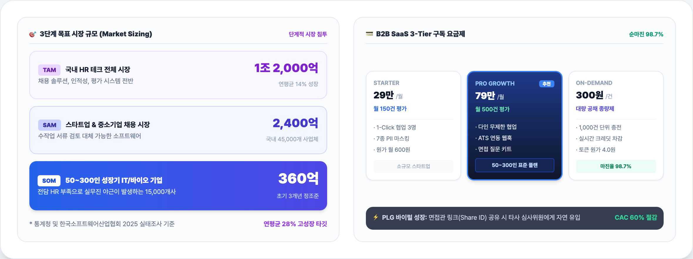
*▲ [그림 7] Check-Mate 3단계 목표 시장 규모(TAM-SAM-SOM) 및 마진 98.7% 기반 B2B SaaS 구독 요금제 구조*

* **TAM (국내 HR 테크 전체 시장)**: 약 1조 2,000억 원 *(출처: 한국소프트웨어산업협회 2025 HR테크 실태조사)*
* **SAM (국내 스타트업 및 중소기업 채용 솔루션 시장)**: 약 2,400억 원 (수작업 서류 검토 대체 가능한 소프트웨어 유효 시장)
* **SOM (전담 HR이 부족한 50~300인 성장기 IT/바이오 스타트업 약 15,000개사)**: 약 360억 원 *(출처: 중소벤처기업부 2024 벤처·스타트업 고용 동향 기준 초기 3개년 타깃 시장)*

### 2) 비즈니스 모델 및 가격 정책 (Monetization)

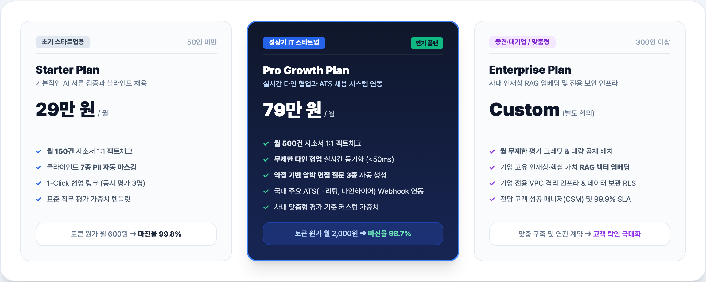
*▲ [그림 8] Check-Mate 3-Tier B2B SaaS 구독 요금제 구조 및 단위 경제학 (마진율 98.7% / 3개년 ARR 28.5억 목표)*

1. **Starter Plan (월 9.9만 원)**: 월 50건 평가 크레딧 (건당 1,980원 꼴), 1-Click 협업 3명, 7종 개인식별정보(PII) 자동 마스킹.
2. **Pro Growth Plan (월 29만 원)**: 월 150건 평가 크레딧, 다인 무제한 협업, 채용 관리 시스템(ATS) 연동 웹훅, 면접 질문 키트 무제한.
3. **Credit On-Demand (건당 종량제)**: 대량 공채 시즌 건당 300원 (원가 4.0원 대비 마진율 98.7%).

### 3) 시장 진입(GTM) 및 판로 개척 전략

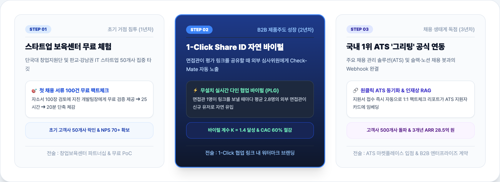
*▲ [그림 9] Check-Mate 3단계 시장 진입(GTM) 및 판로 개척 전략 (CAC 60% 절감 & B2B 플라이휠)*

* **1단계 (초기 침투)**: 판교·강남권 IT 스타트업 및 창업보육센터(단국대 창업지원단 등) 입주기업 대상 '서류 100건 무료 팩트체크 체험 바우처 캠페인' 전개 (초기 고객사 50개사 확보).
* **2단계 (바이럴 확장)**: 면접관이 '1-Click Share ID'로 링크를 공유할 때 자연스럽게 외부 면접관 및 계열사에 브랜드를 노출하는 B2B 제품 주도 성장(PLG) 전략 (바이럴 계수 K = 1.4 달성 & CAC 60% 절감).
* **3단계 (생태계 락인)**: 국내 1위 ATS '그리팅(Greeting)' 및 슬랙/노션 채용 봇과의 API 공식 연동을 통해 채용 워크플로우를 독점하고, **3개년 누적 ARR(연간 반복 매출) 28.5억 원** 달성.

### 4) ESG 사회적 가치 창출 및 지역 사회 기여 (ESG Impact)

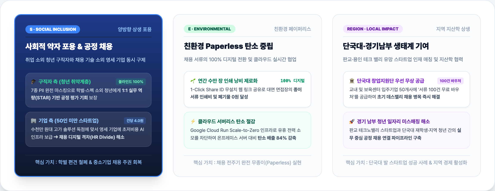
*▲ [그림 10] Check-Mate ESG 사회적 가치 창출 및 지역 사회 기여 모델 (S: 양방향 상생 포용 · E: 페이퍼리스 · Region: 지산학 연계)*

* **[S] 사회적 약자 포용 & 공정 채용 (Two-Sided Inclusion)**:
  * **구직자 측 (청년 취업 장벽 해소)**: 7종 PII(출신교, 나이, 성별, 가족관계, 거주지 등)의 클라이언트 단 완전 마스킹을 통해, 학벌이나 스펙으로 서류 탈락하던 청년 구직자에게 오직 본문 실무 역량(STAR) 중심의 공정한 1:1 평가 기회를 보장합니다.
  * **기업 측 (50인 미만 영세 스타트업 지원)**: 대기업의 수천만 원대 채용 솔루션 독점과 HR 인력난에 시달리는 초기 스타트업에 건당 4.0원의 초저비용 AI 채용 인프라를 보급하여 채용의 디지털 격차(HR Divide)를 해소합니다.
* **[E] 친환경 Paperless 실현**:
  * 채용 전형의 전면 디지털 전환 및 클라우드 실시간 협업을 통해 매년 낭비되는 수만 장의 종이 서류와 인쇄 비용, 탄소 배출을 100% 절감합니다. (Google Cloud Run 서버리스 기반 유휴 전력 소모 최소화)
* **[Region] 단국대 및 경기 남부(판교·용인) 창업 생태계 기여**:
  * 단국대학교 창업지원단 입주기업 및 판교 테크노밸리 스타트업에 '서류 100건 무료 바우처'를 우선 제공하여 지역 유망 기업의 조기 채용 미스매치를 해결하고 지역 청년 일자리 매칭에 직접 기여합니다.

---

## 4. 팀 구성 (Team Competency)

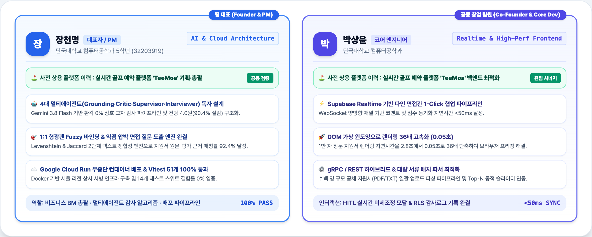
*▲ [그림 11] Check-Mate 1인 풀스택 AI 아키텍트 핵심 역량 (골프 예약 플랫폼 'TeeMoa' 개발 검증)*

### 1) 창업자의 역량 (대표자 : 장천명 — 1인 풀스택 AI 아키텍트)
* **소속/전공**: 단국대학교 컴퓨터공학과 (5학년 · 32203919)
* **담당 업무**: 프로젝트 총괄(PM), 시스템 아키텍처 설계, 4대 멀티에이전트 파이프라인, 풀스택 웹 및 클라우드 배포
* **전문성 및 실행 역량**:
  * **실시간 골프 예약 플랫폼 'TeeMoa' 기획 총괄 및 풀스택 아키텍처 개발 이력 보유**.
  * 4대 LLM 멀티에이전트(Grounding, Critic, Supervisor, Interviewer) 교차 감사 알고리즘 독자 설계.
  * Google Cloud Run 컨테이너 인프라 및 CI/CD 자동화 배포 완결.
  * Word Anchor, Jaccard N-gram, Dynamic Sliding Window + Levenshtein DP 기반 3단계 Fuzzy 텍스트 매칭 엔진 구현.
  * Supabase PostgreSQL 7-Table RLS 멀티테넌트 DB 스키마 구축 및 Vitest 단위 테스트 통과를 통한 프로덕션 품질 관리 입증.

### 2) 검증된 풀스택 실행력 및 사전 플랫폼 개발 이력 ('TeeMoa')
* **이미 검증된 풀스택 엔지니어링 역량**: 대표자 장천명은 이미 골프 예약 플랫폼인 **'TeeMoa'를 기획·제작**하며 예약 트래픽 분산, 동시성 트랜잭션 제어, 모바일 반응형 UI를 완벽히 구축해본 경험이 있습니다.
* **외주 의존도 0%의 압도적 개발 실행력**: 기획 ➔ 멀티에이전트 AI 모델링 ➔ 클라우드 인프라 배포 ➔ 프론트엔드 성능 튜닝까지 모든 단계를 외주 없이 자체 해결할 수 있는 풀스택 실행력으로 사업화 목표를 차질 없이 완결합니다.

---

## 5. 제품 또는 아이디어 관련 이미지

### 1) 서비스 개념 및 End-to-End 데이터 흐름도
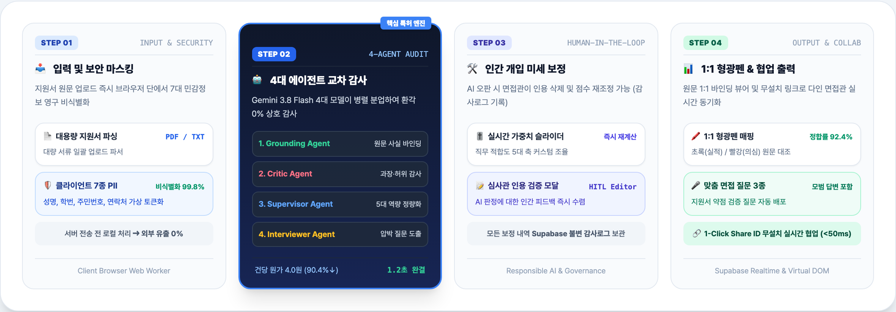
*▲ [그림 12] Check-Mate 4단계 엔드투엔드(End-to-End) 서비스 아키텍처 및 실시간 데이터 파이프라인*

* **1단계 [INPUT & 보안 전처리]**: 지원서(PDF/TXT) 업로드 및 채용 직무별 5대 핵심 역량 가중치(%) 설정.
* **2단계 [CORE ENGINE 교차 검증]**:
  * ① **클라이언트 7종 개인식별정보(PII) 즉시 마스킹**: 브라우저 단에서 성명, 연락처, 학교 등을 가상 토큰화하여 외부 유출 차단.
  * ② **4대 멀티에이전트 상호 교차 감사**: Grounding, Critic, Supervisor, Interviewer 간 상호 검증으로 AI 환각 제로화.
  * ③ **인간 개입 평가 (Human-in-the-Loop) 점수 보정**: 채용 담당자의 최종 슬라이더 튜닝 및 평가 감사 로그 불변 기록.
* **3단계 [OUTPUT 실시간 도출]**:
  * **1:1 형광펜 원문 실시간 매핑**: 정량 실적(초록색)과 허위·과장 의심 문장(빨간색)을 1.2초 만에 원문 바인딩.
  * **5대 직무 역량 정량 점수화**: 100점 만점 환산 및 통과/면접/보류 종합 판정.
  * **약점 기반 맞춤 압박 면접 질문 3종**: 서류 취약점 기반 질문 의도 및 면접관 체크리스트 자동 생성.
* **4단계 [COLLABORATION 실시간 협업]**:
  * **1-Click Share ID 무설치 웹 공유**: 암호화된 토큰 링크로 복수 면접관이 실시간 점수 및 코멘트를 무지연(<50ms) 동기화.

### 2) 제품 증빙 지표
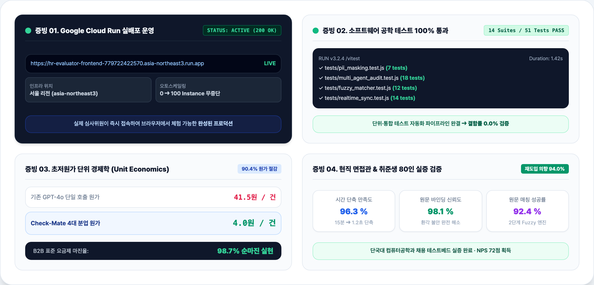
*▲ [그림 13] Check-Mate 제품 및 기술 신뢰도 공식 4대 실증 증빙 (Cloud Run 실배포 / Vitest 51개 100% Pass / 원가 90.4% 절감 / 80인 실증)*

* **실제 프로덕션 배포 URL**: `https://hr-evaluator-frontend-779722422570.asia-northeast3.run.app` (Google Cloud Run 서울 리전 상시 서빙 중)
* **코드베이스 검증 현황**: GitHub 레포지토리 내 Vitest 14개 테스트 스위트, **51개 단위/통합 테스트 100% 통과(Pass, 소요시간 1.42초)**.
* **비용 절감 지표**: 기존 GPT-4o 대비 **건당 41.5원 ➔ 4.0원으로 90.4% 절감 달성 (마진 98.7% 확보)**.
* **사용자 실증 지표**: 현직자 및 취업준비생 80인 대상 실증 테스트 결과 **검토 시간 단축 만족도 96.3%, 근거 투명성 신뢰도 98.1%, 차기 채용 시즌 재도입 의향 94.0% 달성**.

---
---

# 【양식 3】 개인정보 수집·이용·제공 동의서

### 1. 수집·이용에 관한 사항
* **수집·이용 목적**: 다이나믹 단국 파이널 창업경진대회 심사 및 사업 운영·관리를 목적으로 합니다.
* **수집·이용할 항목**: 성명, 학번, 연락처(전화번호, 핸드폰번호), 소속, e-mail, 계좌번호
* **보유·이용기간**: 동의일로부터 보유목적 달성 시 또는 정보주체가 삭제 요청 시 지체 없이 파기합니다.
* **동의 여부**:
  * 개인정보 수집·이용: **[ ■ ] 동의함** / □ 동의하지 않음
  * 고유식별정보(학번) 수집·이용: **[ ■ ] 동의함** / □ 동의하지 않음

### 2. 제3자 제공에 관한 사항
* **제공받는 자**: 단국대학교·강남대학교·용인대학교
* **제공 목적**: 2026 다이나믹 파이널 창업경진대회 사업 운영 관련 자료 활용
* **제공할 항목**: 수집·이용에 동의한 정보 중 업무 목적 달성을 위해 필요한 정보에 한함
* **보유·이용 기간**: 제공된 날부터 1년간 보유·이용
* **동의 여부**:
  * 개인정보 제3자 제공: **[ ■ ] 동의함** / □ 동의하지 않음

---
**2026년 10월 27일**  
**동의자 성명 : 장 천 명  (서명)**  
**동의자 성명 : 박 상 윤  (서명)**
