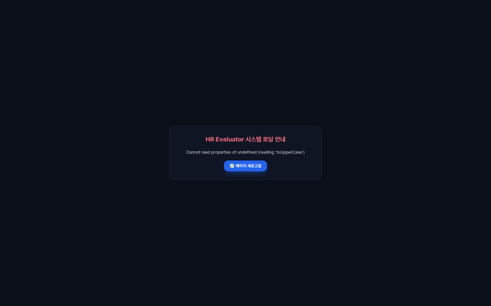
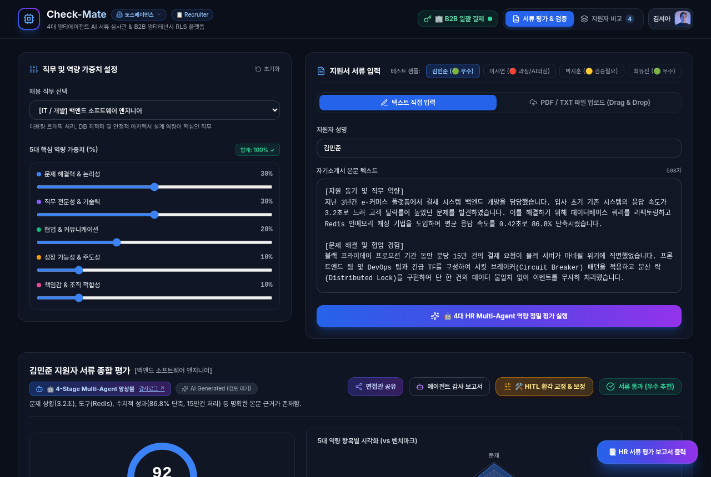
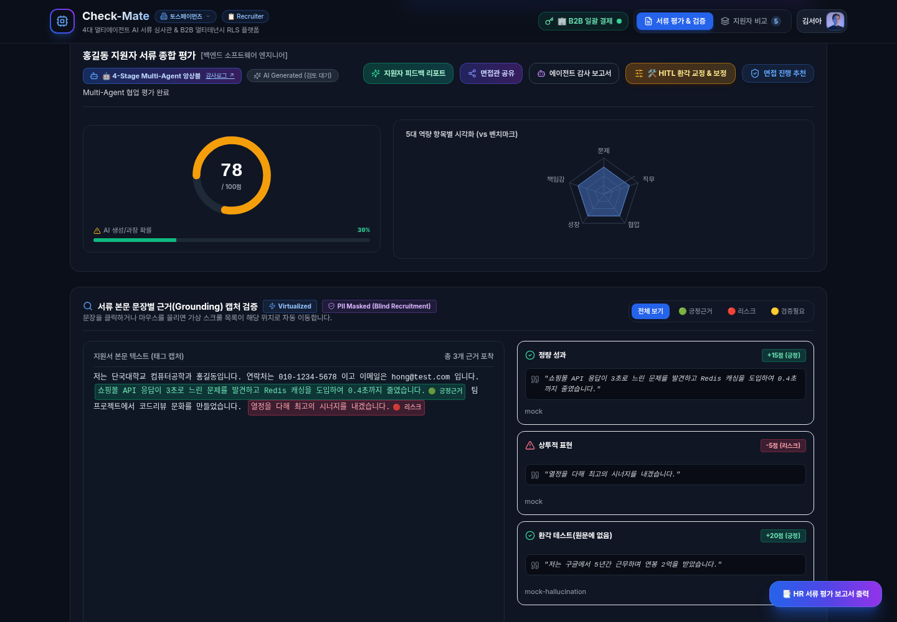

# 🔍 사용자 시나리오 트러블슈팅 리포트 (2026-11-12)

> **한 줄 결론**: 화면 기능(형광펜, HITL, 공유, 비교, 업로드)은 대부분 동작하지만, **핵심인 AI 자소서 분석은 라이브에서 어떤 경로로도 동작하지 않습니다.** 최신 코드(main)에서는 연결 경로가 고쳐졌지만, **환각 방지 장치가 작동하지 않고 화면에 개인정보 원본이 노출되는** 핵심 결함 2건이 새로 확인됐습니다.

- 점검 대상
  - **라이브**: `hr-evaluator-frontend-…run.app` (배포본 `last-modified: 2026-10-20`, 즉 **3주 전 버전**)
  - **로컬 최신**: `main@b608991` (PR #67까지 반영), `npm run dev` + `node server/index.js`
- 점검 방법: 헤드리스 Chrome으로 실제 버튼 클릭 (`scripts/e2e-smoke/`), 네트워크·콘솔·alert 기록, curl로 API 직접 호출
- AI 검증: 실제 Gemini 키가 없어 **Gemini 응답만 가짜(mock)로 바꿔 끼우고** 나머지 파이프라인(PII 마스킹 → 4대 에이전트 → 원문 매칭 → 형광펜)은 실제 코드로 실행

---

## 1. 시나리오별 결과 (사용자 입장)

| # | 사용자 시나리오 | 라이브 (10/20 배포본) | 로컬 최신 (main) |
|:-:|---|:-:|:-:|
| S01 | 첫 화면 접속 | ⚠️ AI를 돌리지 않았는데 **92점 결과가 이미 떠 있음** (샘플 데이터, "샘플" 표시 없음) | ⚠️ 동일 |
| S02 | 샘플 지원자로 **AI 평가 실행** (기본 B2B 모드) | ❌ `Unexpected token '<'` 알림 | ❌ `GEMINI_API_KEY가 설정되지 않았습니다` 알림 (서버 키 미설정, **정직한 에러로 개선**) |
| S03 | 자소서 직접 입력 → AI 평가 | ❌ 위와 동일 | ❌ 위와 동일 (실패 시 API 키 설정 창 자동 오픈) |
| S04 | 근거 카드 클릭 → 본문 형광펜 | ✅ (샘플 결과 기준) | ✅ |
| S05 | HITL 환각 교정 모달 열기/저장 | ✅ "최종 판단은 본인" 문구 있음 | ✅ |
| S06 | 면접관 공유 링크 생성 | ⚠️ 링크는 생기지만 **서버 저장 실패** (`POST /api/v1/shares` → HTML 200) | ✅ `201` 저장됨 |
| S07 | 공유 링크를 다른 기기에서 열기 | ❌ 공유된 평가가 아니라 **기본 첫 화면**이 뜸 | ✅ "🔗 실시간 동기화된" 공유 화면 |
| S08 | 면접관 메모 + 점수 가감 등록 | ✅ (현재 브라우저 내) | ✅ |
| S09 | 지원자 비교 탭 (표절 매트릭스, Top-N) | ⚠️ 표절 ✅ / Top-N ❌ | ✅ 표절 + Top-N 컷오프 |
| S10 | 회사(테넌트) 전환 토스 → 당근 | ✅ (브라우저 localStorage 기준) | ✅ |
| S12 | **HR 평가 보고서 출력** | ❌ **앱 전체 크래시** `Cannot read properties of undefined (reading 'toUpperCase')` | ✅ 모달 열림 |
| S13 | TXT 파일 업로드 | ✅ | ✅ |
| S14 | 개인 API 키(BYOK) 모드로 평가 | ❌ **존재하지 않는 모델**(`gemini-3.8-flash`, `gemini-3.5-flash-lite`)만 호출 → 진짜 키여도 실패 | ⚠️ 실제 모델(`gemini-2.5-flash`→2.0→1.5) 호출로 개선. 단, 키가 틀려도(400) 모델 3종×2회 = **6번 재시도** |

스크린샷: [`screenshots/`](screenshots/)

| 라이브 보고서 출력 크래시 | 공유 링크가 열리지 않음 | 환각 인용 + PII 노출 (로컬 최신) |
|---|---|---|
|  |  |  |

---

## 2. 핵심: AI 분석 기능 상태

### 2-1. 라이브 — 두 경로 모두 실패

| 경로 | 무엇이 일어나나 | 원인 |
|---|---|---|
| ① 앱이 실제로 쓰는 경로 | 프론트가 `프론트 자기 주소/api/v1/evaluate`로 요청 → **nginx가 index.html(200)을 돌려줌** → JSON 파싱 에러 | 빌드 시 `VITE_API_GATEWAY_URL` 미주입. 미주입 시 `window.location.origin`으로 폴백하는 코드(`src/services/aiEvaluator.js`, `shareService.js`)가 **최신 코드에도 그대로** 있음 |
| ② 게이트웨이 직접 호출 (curl) | `502 UPSTREAM_AI_FAILED` — `403 … API has not been used in project ai-review-510606 before or it is disabled` | **GCP 프로젝트에서 Gemini API가 비활성화** (게이트웨이 배포본도 구버전) |
| ③ 개인 키(BYOK) | 브라우저가 Google API를 **키를 URL 쿼리에 붙여** 직접 호출. 모델이 없는 ID라 실패 | 구버전 모델 ID (#37-3, 최신 main에서는 수정됨) |

### 2-2. 로컬 최신 — Gemini 응답을 mock으로 바꿔 파이프라인 전체 실행

테스트 입력: `저는 단국대학교 컴퓨터공학과 홍길동입니다. 연락처는 010-1234-5678 …` + mock Grounding Agent가 **원문에 없는 문장**("저는 구글에서 5년간 근무하며 연봉 2억을 받았습니다.")을 근거로 끼워 넣음

| 확인 항목 | 결과 |
|---|---|
| 4대 에이전트 호출 | ✅ Grounding → Critic → Supervisor ∥ Interviewer, 총 4회 호출 |
| **AI에게 보내는 프롬프트의 PII** | ✅ 이름·학교·전화·이메일 모두 마스킹되어 전송 |
| **화면 본문의 PII** | ❌ "PII Masked (Blind Recruitment)" 배지 아래에 **단국대학교 / 010-1234-5678 / hong@test.com 원문 노출** (#37-2 미해결) |
| 원문 문장 형광펜 매칭 | ✅ 실제 문장 2개 하이라이트 |
| **환각 인용 처리** | ❌ 원문에 없는 문장이 **`+20점 (긍정)` 근거 카드로 그대로 표시**. 설계상 매칭 실패 시 `verify(검증필요)`로 강제 전환돼야 하지만 코드에 해당 로직이 없음 (`src/services/workerService.js:36`, `src/workers/evaluatorWorker.js:32`) |
| 점수/판정/면접질문 | ✅ mock Supervisor 77점 → 화면 78점(보정 반영), mock 질문 표시 |

> 즉 "**환각 0%**"를 보장한다는 핵심 안전장치가 실제로는 동작하지 않습니다. 실제 Gemini를 붙이기 전에 반드시 고쳐야 합니다.

---

## 3. 라이브 서비스까지 부족한 점

| 영역 | 현재 | 라이브 서비스에 필요한 것 |
|---|---|---|
| **배포** | 라이브가 10/20 버전에 멈춰 있음. Spring 서버는 미배포 | main 기준 재배포 + 빌드 시 `VITE_API_GATEWAY_URL` 주입을 CI에서 강제 |
| **AI 연동** | 서버 키 없음 / GCP API 비활성 | 서버측 키 보관(Secret Manager) + API 활성화 → [ADR 문서](../adr/ADR-AI-01_api-vs-mcp.md) 참고 |
| **AI 신뢰성** | 환각 인용이 긍정 근거로 표시 | 매칭 실패 → `verify` 강제, 테스트 추가 |
| **개인정보** | 화면에 원본 PII 노출, 브라우저 키 URL 노출 | 기본은 마스킹본 표시, 원본은 권한자만 / 키는 서버에만 |
| **인증·권한** | 프론트 로그인 항상 `true`, Spring API 전부 `permitAll` + URL 경로의 tenantId 신뢰 | JWT 로그인, 토큰에서 tenantId 추출, 다른 회사 데이터 접근 차단 |
| **데이터 저장** | 지원자·평가는 브라우저 localStorage, 공유는 게이트웨이 JSON 파일 | Spring + PostgreSQL로 일원화 (프론트 ↔ Spring 연결 아직 0건) |
| **첫 화면 신뢰도** | 샘플 결과가 실제 결과처럼 보임 | "샘플 데이터" 배지 또는 빈 상태로 시작 |
| **디자인** | 어두운 화면 + 이모지·영문 마케팅 문구로 "AI가 만든 티"가 강함 | 밝은 테마, 기능 탐색(검색·메뉴) 중심 메인 (29번) |
| **비용/안정성** | 잘못된 키에도 6회 호출 | 400/401/403은 재시도하지 않기, 레이트리밋·타임아웃 |

---

## 4. 다음 할 일 (큐)

[`tasks/00_INDEX.md`](../../tasks/00_INDEX.md) 20~30번으로 등록했습니다. **위에서부터 순서대로** 진행합니다.

| 순서 | ID | 작업 | 우선순위 |
|:-:|:-:|---|:-:|
| 1 | 20 | 환각 인용(원문 매칭 실패) → `verify` 강제 전환 | P0 |
| 2 | 21 | 화면 본문 PII 원본 노출 수정 (#37-2) | P0 |
| 3 | 22 | 캐시 키에 테넌트·Prompt Studio 설정 포함 (#37-4) | P1 |
| 4 | 23 | Spring API 인증 + 테넌트 격리 (permitAll 제거) | P0 |
| 5 | 24 | 프론트 API 주소 빌드 설정 강제 + 라이브 재배포 | P0 |
| 6 | 25 | BYOK 모드 개선 (무의미한 재시도, 키 URL 노출, 헤더 표시) | P2 |
| 7 | 26 | 첫 화면 샘플 결과에 "샘플" 표시 | P2 |
| 8 | 27 | #21~#23 Spring 기준 갱신 + 프론트 ↔ Spring 연결 | P1 |
| 9 | 28 | **AI 실연동** (서버측 Gemini API, ADR-AI-01) | 후순위 |
| 10 | 29 | 메인 화면 디자인 개편 (밝은 테마, 검색/메뉴로 구현됨·준비 중 기능 노출) | 후순위 |
| 11 | 30 | 카페 피드백(#47) 미구현 기능 백로그 | 후순위 |

---

## 5. 재현 방법

```bash
# 1) 로컬 서버 실행
npm ci
PORT=3001 node server/index.js                                   # 게이트웨이
VITE_API_GATEWAY_URL=http://localhost:3001 npx vite --port 3000  # 프론트

# 2) 시나리오 실행 (Chrome 필요, playwright-core는 저장 없이 임시 설치)
npm i --no-save playwright-core@1.48.2
node scripts/e2e-smoke/scenarios.mjs http://localhost:3000 ./tmp-shots
node scripts/e2e-smoke/mock_ai.mjs   http://localhost:3000 ./tmp-shots   # AI 파이프라인(mock) 검증
```

자세한 설명: [`scripts/e2e-smoke/README.md`](../../scripts/e2e-smoke/README.md)
